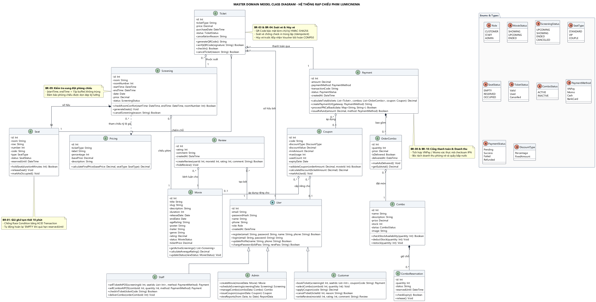

# TÀI LIỆU THUYẾT MINH KIẾN TRÚC SƠ ĐỒ LỚP TOÀN HỆ THỐNG
## HỆ THỐNG QUẢN LÝ VÀ ĐẶT VÉ RẠP CHIẾU PHIM LUMICINEMA
### Master Domain Model Class Diagram & Defense Handbook

---

## MỤC LỤC TỔNG QUAN

1. [Tổng Quan Kiến Trúc Sơ Đồ Lớp (Architecture Overview)](#1-tổng-quan-kiến-trúc-sơ-đồ-lớp-architecture-overview)
   - 1.1. Sơ đồ lớp tổng thể (Embedded Visual Diagram)
   - 1.2. Triết lý thiết kế: Rich Domain Model vs. Anemic Domain Model
   - 1.3. Nguyên tắc thiết kế Hướng đối tượng (SOLID & DDD)
2. [Đặc Tả Chi Tiết Các Lớp Thực Thể & Enums (Entity Specifications)](#2-đặc-tả-chi-tiết-các-lớp-thực-thể--enums-entity-specifications)
   - 2.1. Phân hệ Người dùng & Phân quyền RBAC (`User`, `Customer`, `Staff`, `Admin`)
   - 2.2. Phân hệ Phim, Suất chiếu & Bảng giá vé (`Movie`, `Screening`, `Seat`, `Pricing`)
   - 2.3. Phân hệ Vé, Thanh toán & Mã ưu đãi (`Ticket`, `Payment`, `Coupon`)
   - 2.4. Phân hệ Bắp nước (Concession) & Đánh giá (`Combo`, `OrderCombo`, `ComboReservation`, `Review`)
   - 2.5. Hệ thống 10 Kiểu liệt kê chuẩn hóa (`Enums & Types`)
   - 2.6. Ma trận truy vết nghiệp vụ (Traceability Matrix: Class - Sequence - BR - DB)
3. [Phân Tích Chuyên Sâu Các Mối Quan Hệ Hướng Đối Tượng (OOP Relationships Analysis)](#3-phân-tích-chuyên-sâu-các-mối-quan-hệ-hướng-đối-tượng-oop-relationships-analysis)
   - 3.1. Quan hệ Kế thừa (Generalization) & Mẫu Single Table Inheritance
   - 3.2. Quan hệ Hợp thành (Composition) & Ràng buộc vòng đời sinh tử (Lifecycle Coupling)
   - 3.3. Quan hệ Kết tập (Aggregation) & Tính độc lập của thực thể
   - 3.4. Xóa bỏ Object-Relational Impedance Mismatch (Bất tương thích Đối tượng - Quan hệ)
4. [Bộ 10 Câu Hỏi Vấn Đáp Trọng Tâm Về Sơ Đồ Lớp (Top 10 Q&A Defense for Examination Committee)](#4-bộ-10-câu-hỏi-vấn-đáp-trọng-tâm-về-sơ-đồ-lớp-top-10-qa-defense-for-examination-committee)

---

## 1. TỔNG QUAN KIẾN TRÚC SƠ ĐỒ LỚP (ARCHITECTURE OVERVIEW)

### 1.1. Sơ đồ lớp tổng thể (Embedded Visual Diagram)

Sơ đồ lớp miền nghiệp vụ tổng thể (**Master Domain Model Class Diagram**) mô hình hóa toàn bộ cấu trúc tĩnh, mối quan hệ thực thể, thuộc tính đóng gói và hành vi nghiệp vụ cốt lõi của Hệ thống Rạp chiếu phim LumiCinema.



> 🔗 **Định dạng Vector chất lượng cao:** [Xem file vector chất lượng cao (SVG)](class_diagram_lumicinema.svg)  
> 📄 **File mã nguồn đặc tả PlantUML:** [`class_diagram_lumicinema.puml`](class_diagram_lumicinema.puml)

---

### 1.2. Triết lý thiết kế: Rich Domain Model vs. Anemic Domain Model

Trong công nghệ phần mềm và thiết kế hướng đối tượng (OOAD), một trong những sai lầm phổ biến nhất khi xây dựng sơ đồ lớp là rơi vào bẫy **Mô hình Miền Thiếu máu (Anemic Domain Model)** — thuật ngữ được kiến trúc sư phần mềm Martin Fowler định nghĩa:
* *Anemic Domain Model:* Các lớp thực thể chỉ hoạt động như cấu trúc dữ liệu thô (Data Containers / DTOs), chứa thuộc tính và getter/setter thụ động; toàn bộ quy tắc nghiệp vụ, tính toán logic và xác thực trạng thái bị bóc tách ra ngoài và nhồi nhét vào các lớp Service khổng lồ (`ScreeningService`, `BookingService`, `PaymentService`). Điều này vi phạm nghiêm trọng tính đóng gói (Encapsulation) và biến lập trình hướng đối tượng thành lập trình thủ tục (Procedural Programming) đội lốt đối tượng.
* *Rich Domain Model (Mô hình Miền Giàu Nghiệp vụ):* Kiến trúc LumiCinema kiên định tuân thủ tư tưởng **Domain-Driven Design (DDD)** của Eric Evans và Martin Fowler. Dữ liệu và các hành vi xử lý trên chính dữ liệu đó được đóng gói chặt chẽ bên trong cùng một thực thể (Information Expert Pattern):
  * Lớp `Seat` tự quản lý hành vi giữ chỗ `holdSeat()` và kiểm tra hết hạn `reservedUntil` thay vì phó mặc cho dịch vụ bên ngoài.
  * Lớp `Screening` tự chứa thuật toán kiểm tra xung đột phòng chiếu `checkRoomConflict()` và tự kích hoạt khởi tạo 50 ghế ngồi `generateSeats()`.
  * Lớp `Ticket` tự tạo mã QR kèm chữ ký số `generateQRCode()`, tự kiểm tra tính hợp lệ chữ ký `verifyQRCode()` và tự thực hiện quy trình soát vé `checkIn()`.
  * Lớp `Payment` tự tính toán tổng tiền thanh toán sau khi trừ khuyến mãi `calculateTotal()` và xử lý phản hồi từ cổng thanh toán `processIPNCallback()`.

```
┌──────────────────────────────────────────────────────────────────────────────────┐
│                             SO SÁNH MÔ HÌNH THIẾT KẾ                             │
├────────────────────────────────────────┬─────────────────────────────────────────┤
│    ANEMIC DOMAIN MODEL (Mô hình cũ)    │   RICH DOMAIN MODEL (LumiCinema áp dụng)│
├────────────────────────────────────────┼─────────────────────────────────────────┤
│ • Lớp chỉ có thuộc tính + Get/Set thụ  │ • Dữ liệu và Hành vi nghiệp vụ đóng gói │
│   động. Logic bị rò rỉ ra Service.     │   chặt chẽ bên trong cùng một lớp.      │
│ • Vi phạm nguyên tắc Đóng gói          │ • Đảm bảo Information Expert (GRASP):   │
│   (Encapsulation) và Information       │   Thực thể nào nắm dữ liệu sẽ đảm nhiệm │
│   Hiding.                              │   xử lý dữ liệu đó.                     │
│ • Dễ dẫn đến mã nguồn phân mảnh, trùng │ • Tính tái sử dụng cao, dễ dàng kiểm thử│
│   lặp logic nghiệp vụ ở nhiều nơi.     │   đơn vị (Unit Test) cho từng Entity.   │
└────────────────────────────────────────┴─────────────────────────────────────────┘
```

---

### 1.3. Nguyên tắc thiết kế Hướng đối tượng (SOLID & DDD)

Kiến trúc Sơ đồ lớp LumiCinema được thiết kế dựa trên các nguyên lý chuẩn mực:
1. **Single Responsibility Principle (SRP):** Mỗi lớp chỉ chịu trách nhiệm cho một miền ngữ nghĩa duy nhất: `Seat` chịu trách nhiệm về tọa độ và trạng thái chỗ ngồi; `Pricing` quản lý công thức tỷ lệ vé; `Coupon` quản lý điều kiện khấu trừ voucher.
2. **Open/Closed Principle (OCP):** Cấu trúc phân loại người dùng được mở rộng thông qua kế thừa (`User` làm lớp cha trừu tượng; các vai trò `Customer`, `Staff`, `Admin` mở rộng hành vi riêng biệt mà không làm biến đổi lớp cha).
3. **Liskov Substitution Principle (LSP):** Mọi đối tượng `Customer`, `Staff`, hay `Admin` đều có thể thay thế hoàn hảo cho lớp cơ sở `User` trong các tác vụ định danh, xác thực và quản lý tài khoản cơ bản.
4. **Information Hiding (Che giấu thông tin):** 100% thuộc tính của tất cả các lớp được khai báo phạm vi truy cập `private` (`-`). Truy cập và biến đổi dữ liệu bắt buộc phải thông qua các phương thức công khai `public` (`+`) có kiểm soát điều kiện biên.

---

## 2. ĐẶC TẢ CHI TIẾT CÁC LỚP THỰC THỂ & ENUMS (ENTITY SPECIFICATIONS)

Hệ thống bao gồm **12 Lớp Thực thể cốt lõi**, **3 Lớp con chuyên biệt hóa**, và **10 Kiểu liệt kê chuẩn hóa (Enums)**, được phân chia theo 4 phân hệ chức năng hoàn chỉnh.

### 2.1. Phân hệ Người dùng & Phân quyền RBAC

Phân hệ định danh, xác thực và phân quyền điều hướng ứng dụng dựa trên Role-Based Access Control (RBAC).

#### 1. Lớp Trừu tượng `User` (`abstract class User`)
* **Vai trò & Trách nhiệm:** Lớp cha trừu tượng đại diện cho mọi cá nhân tương tác với hệ thống. Lưu trữ thông tin tài khoản chung, quản lý đăng ký, đăng nhập và bảo mật mật khẩu băm.
* **Đặc tả Thuộc tính:**
  * `- id: Int`: Định danh duy nhất (Khóa chính tự tăng).
  * `- email: String`: Địa chỉ thư điện tử duy nhất, dùng làm tên đăng nhập (RFC 5322).
  * `- passwordHash: String`: Mật khẩu đã băm bảo mật bằng thuật toán Bcrypt (Salt rounds = 12).
  * `- name: String`: Họ và tên đầy đủ của người dùng.
  * `- phone: String`: Số điện thoại liên hệ (Định dạng chuẩn 10 chữ số).
  * `- role: Role`: Vai trò phân quyền (`CUSTOMER`, `STAFF`, `ADMIN`).
  * `- createdAt: DateTime`: Thời điểm khởi tạo tài khoản trong hệ thống.
* **Đặc tả Phương thức Nghiệp vụ:**
  * `+ register(email: String, password: String, name: String, phone: String): Boolean`: Đăng ký tài khoản mới; kiểm tra trùng lặp email và băm mật khẩu.
  * `+ login(email: String, password: String): String`: Xác thực đăng nhập; so khớp Bcrypt hash và cấp phát JWT Session Token (hạn 24 giờ).
  * `+ updateProfile(name: String, phone: String): Boolean`: Cập nhật thông tin cá nhân cơ bản.
  * `+ changePassword(oldPass: String, newPass: String): Boolean`: Đổi mật khẩu; xác thực mật khẩu cũ trước khi ghi nhận mật khẩu mới.

#### 2. Lớp Con Chuyên biệt `Customer` (`class Customer extends User`)
* **Vai trò & Trách nhiệm:** Đại diện cho Khách hàng xem phim trực tuyến.
* **Đặc tả Phương thức Nghiệp vụ:**
  * `+ bookTicket(screeningId: Int, seatIds: List<Int>, couponCode: String): Payment`: Thực hiện chu trình đặt vé trực tuyến, khóa giữ ghế và khởi tạo hóa đơn thanh toán.
  * `+ selectCombo(comboId: Int, quantity: Int): Void`: Chọn thêm bắp nước vào đơn hàng hiện tại.
  * `+ applyCoupon(code: String): Decimal`: Kiểm tra điều kiện và tính toán số tiền giảm giá của voucher.
  * `+ cancelTicket(ticketId: Int, reason: String): Boolean`: Khách chủ động hủy vé trước giờ chiếu $\ge 2$ tiếng (`BR-03`), nhận mã Voucher bồi hoàn 50%.
  * `+ writeReview(movieId: Int, rating: Int, comment: String): Review`: Đăng bài đánh giá phim (từ 1 đến 5 sao) sau khi đăng nhập (`BR-06`).

#### 3. Lớp Con Chuyên biệt `Staff` (`class Staff extends User`)
* **Vai trò & Trách nhiệm:** Đại diện cho Nhân viên phục vụ tại quầy rạp chiếu phim (POS & Soát vé).
* **Đặc tả Phương thức Nghiệp vụ:**
  * `+ sellTicketAtPOS(screeningId: Int, seatIds: List<Int>, method: PaymentMethod): Payment`: Bán vé trực tiếp tại quầy bằng tiền mặt hoặc thẻ POS (`FR-POS-01`).
  * `+ sellComboAtPOS(comboId: Int, quantity: Int, method: PaymentMethod): Payment`: Bán combo bắp nước trực tiếp tại quầy (`FR-POS-03`).
  * `+ checkInTicket(ticketCode: String): Boolean`: Quét mã QR soát vé khách vào rạp; kiểm tra chữ ký HMAC-SHA256 và trạng thái vé (`BR-09`).
  * `+ deliverCombo(orderComboId: Int): Void`: Giao nhận bắp nước cho khách đã đặt online độc lập với luồng soát vé (`BR-05`).

#### 4. Lớp Con Chuyên biệt `Admin` (`class Admin extends User`)
* **Vai trò & Trách nhiệm:** Đại diện cho Quản trị viên điều hành toàn bộ rạp chiếu phim.
* **Đặc tả Phương thức Nghiệp vụ:**
  * `+ createMovie(movieData: Movie): Movie`: Thêm mới phim vào danh mục rạp.
  * `+ scheduleScreening(screeningData: Screening): Screening`: Lên lịch chiếu mới, kích hoạt tự động sinh 50 ghế ngồi.
  * `+ manageCombo(comboData: Combo): Combo`: Thêm mới, điều chỉnh giá hoặc cập nhật tồn kho bắp nước.
  * `+ issueCoupon(couponData: Coupon): Coupon`: Phát hành mã giảm giá hoặc chiến dịch khuyến mãi mới.
  * `+ viewReports(from: Date, to: Date): ReportData`: Truy xuất báo cáo tài chính đa chiều, bóc tách doanh thu thực thu và công nợ hoàn tiền (`BR-10`).

---

### 2.2. Phân hệ Phim, Suất chiếu & Bảng giá vé

Phân hệ quản lý nội dung điện ảnh, điều phối lịch chiếu theo phòng và định nghĩa quy chế tính giá vé linh hoạt.

#### 5. Lớp Thực thể `Movie` (`class Movie`)
* **Vai trò & Trách nhiệm:** Đại diện cho một tác phẩm điện ảnh trong danh mục phát hành của rạp.
* **Đặc tả Thuộc tính:**
  * `- id: Int`: Định danh duy nhất của bộ phim.
  * `- title: String`: Tên chính thức của bộ phim.
  * `- slug: String`: Chuỗi định danh URL thân thiện (SEO).
  * `- description: String`: Tóm tắt nội dung kịch bản phim.
  * `- duration: Int`: Thời lượng phim (tính theo phút).
  * `- releaseDate: Date`: Ngày khởi chiếu chính thức.
  * `- endDate: Date`: Ngày kết thúc công chiếu dự kiến.
  * `- ageRating: String`: Nhãn phân loại độ tuổi (`P`, `K`, `T13`, `T16`, `T18`, `C`).
  * `- poster: String`: Đường dẫn hình ảnh áp-phích quảng bá.
  * `- trailer: String`: Đường dẫn video trailer chính thức.
  * `- genre: String`: Thể loại phim (Hành động, Tâm lý, Hoạt hình,...).
  * `- rating: Decimal`: Điểm đánh giá trung bình của khán giả (Thang điểm 1.0 - 5.0).
  * `- status: MovieStatus`: Trạng thái phát hành (`SHOWING`, `UPCOMING`, `ENDED`).
  * `- ticketPrice: Decimal`: Giá vé cơ sở định mức cho bộ phim (Mặc định 120,000 VNĐ).
* **Đặc tả Phương thức Nghiệp vụ:**
  * `+ getActiveScreenings(): List<Screening>`: Lấy danh sách các suất chiếu đang mở bán của phim.
  * `+ calculateAverageRating(): Decimal`: Tính toán lại điểm số đánh giá trung bình từ danh sách `Review`.
  * `+ updateStatus(newStatus: MovieStatus): Void`: Cập nhật trạng thái chiếu phim (Ngừng chiếu thay vì xóa vật lý theo `BR-07`).

#### 6. Lớp Thực thể `Screening` (`class Screening`)
* **Vai trò & Trách nhiệm:** Đại diện cho một suất chiếu cụ thể của một bộ phim tại một phòng chiếu vào một khung giờ xác định.
* **Đặc tả Thuộc tính:**
  * `- id: Int`: Định danh suất chiếu duy nhất.
  * `- room: String`: Tên phòng chiếu (Ví dụ: "Cinema 01").
  * `- roomNumber: Int`: Số hiệu phòng chiếu vật lý (1 đến 5).
  * `- startTime: DateTime`: Thời điểm bắt đầu trình chiếu.
  * `- endTime: DateTime`: Thời điểm kết thúc trình chiếu (Bằng `startTime` + `Movie.duration`).
  * `- date: Date`: Ngày diễn ra suất chiếu.
  * `- price: Decimal`: Giá vé áp dụng cho suất chiếu.
  * `- status: ScreeningStatus`: Trạng thái suất chiếu (`UPCOMING`, `SHOWING`, `ENDED`, `CANCELLED`).
* **Đặc tả Phương thức Nghiệp vụ:**
  * `+ checkRoomConflict(startTime: DateTime, endTime: DateTime, roomNumber: Int): Boolean`: Kiểm tra xung đột phòng chiếu theo `BR-08` (Khoảng cách giữa hai suất liên tiếp $\ge$ Thời lượng + 15 phút dọn dẹp vệ sinh phòng).
  * `+ generateSeats(): Void`: Tự động khởi tạo đầy đủ 50 bản ghi ghế ngồi (`Seat`) tương ứng từ hàng A đến E, số 1 đến 10 (`BR-01`).
  * `+ cancelScreening(reason: String): Boolean`: Hủy suất chiếu do sự cố rạp (`BR-04`), kích hoạt hoàn trả 100% tiền mặt cho khán giả đã mua vé.

#### 7. Lớp Thực thể `Seat` (`class Seat`)
* **Vai trò & Trách nhiệm:** Quản lý trạng thái và thời gian giữ chỗ của một vị trí ghế ngồi cụ thể thuộc một suất chiếu xác định.
* **Đặc tả Thuộc tính:**
  * `- id: Int`: Định danh duy nhất của ghế ngồi.
  * `- room: String`: Tên phòng chiếu chứa ghế.
  * `- row: String`: Ký tự hàng ghế ("A", "B", "C", "D", "E").
  * `- number: Int`: Số thứ tự ghế trong hàng (1 đến 10).
  * `- code: String`: Mã định danh hiển thị trên sơ đồ phòng (Ví dụ: "A1", "C5", "E10").
  * `- type: SeatType`: Hạng ghế (`STANDARD`, `VIP`, `COUPLE`).
  * `- status: SeatStatus`: Trạng thái thời gian thực (`EMPTY`, `RESERVED`, `OCCUPIED`).
  * `- reservedUntil: DateTime`: Mốc thời gian hết hạn giữ chỗ tạm thời (Mặc định 10 phút).
* **Đặc tả Phương thức Nghiệp vụ:**
  * `+ holdSeat(durationMinutes: Int): Boolean`: Thực hiện giữ ghế tạm thời trong 10 phút (`BR-01`), chuyển trạng thái thành `RESERVED` và gán hạn `reservedUntil`.
  * `+ releaseSeat(): Void`: Giải phóng ghế về trạng thái `EMPTY` khi quá hạn giữ chỗ hoặc đơn hàng bị hủy bỏ.
  * `+ markAsOccupied(): Void`: Đánh dấu ghế đã bán thành công (`OCCUPIED`) ngay sau khi thanh toán hóa đơn hoàn tất.

#### 8. Lớp Thực thể `Pricing` (`class Pricing`)
* **Vai trò & Trách nhiệm:** Quản lý bảng tỷ lệ định giá vé linh hoạt theo đối tượng khán giả và hạng ghế ngồi.
* **Đặc tả Thuộc tính:**
  * `- id: Int`: Định danh cấu hình giá.
  * `- ticketType: String`: Mã phân loại vé ("Normal", "Child", "VIP", "Couple").
  * `- label: String`: Tên hiển thị người dùng ("Vé Thường", "Vé Trẻ Em 50%", "Ghế VIP").
  * `- percentage: Int`: Tỷ lệ phần trăm tính theo giá cơ sở (100%, 50%, 120%, 180%).
  * `- basePrice: Decimal`: Giá vé sàn cơ sở.
  * `- description: String`: Ghi chú mô tả và quy định áp dụng độ tuổi (`BR-02`).
* **Đặc tả Phương thức Nghiệp vụ:**
  * `+ calculateFinalPrice(basePrice: Decimal, seatType: SeatType): Decimal`: Thuật toán tính toán giá vé cuối cùng dựa trên sự kết hợp giữa loại vé khán giả và hệ số phụ thu hạng ghế.

---

### 2.3. Phân hệ Vé, Thanh toán & Mã ưu đãi

Phân hệ đảm nhiệm khâu giao dịch tài chính, phát hành vé điện tử có chữ ký bảo mật và áp dụng khuyến mãi.

#### 9. Lớp Thực thể `Ticket` (`class Ticket`)
* **Vai trò & Trách nhiệm:** Đại diện cho chiếc vé xem phim điện tử hợp pháp cấp phát cho khách hàng.
* **Đặc tả Thuộc tính:**
  * `- id: Int`: Định danh duy nhất của vé xem phim.
  * `- ticketType: String`: Loại vé đã chọn ("Normal", "Child",...).
  * `- price: Decimal`: Số tiền thực tế thanh toán cho chiếc vé.
  * `- purchaseDate: DateTime`: Thời điểm mua vé thành công.
  * `- status: TicketStatus`: Trạng thái vòng đời của vé (`Valid`, `Used`, `Cancelled`).
  * `- cancellationReason: String`: Lý do hủy vé (Khách hủy nhận voucher hoặc Rạp hủy do sự cố).
* **Đặc tả Phương thức Nghiệp vụ:**
  * `+ generateQRCode(): String`: Tạo chuỗi dữ liệu mã QR tích hợp thông tin vé và chữ ký số HMAC-SHA256 bí mật (`BR-09`).
  * `+ verifyQRCode(signature: String): Boolean`: So khớp chữ ký số HMAC-SHA256 nhằm ngăn chặn tuyệt đối tình trạng vé giả mạo.
  * `+ checkIn(): Boolean`: Ghi nhận soát vé vào rạp, chuyển trạng thái từ `Valid` sang `Used`; ngăn chặn check-in lặp lại (Tính Idempotent).
  * `+ cancelTicket(reason: String): Boolean`: Hủy vé theo quy chế `BR-03` hoặc `BR-04`, cập nhật trạng thái `Cancelled`.

#### 10. Lớp Thực thể `Payment` (`class Payment`)
* **Vai trò & Trách nhiệm:** Đại diện cho hóa đơn thanh toán hợp nhất, tích hợp cổng thanh toán trực tuyến và ghi nhận dòng tiền.
* **Đặc tả Thuộc tính:**
  * `- id: Int`: Định danh duy nhất của hóa đơn thanh toán.
  * `- amount: Decimal`: Tổng giá trị tiền tệ thực thanh toán sau khi trừ khuyến mãi.
  * `- paymentMethod: PaymentMethod`: Phương thức thanh toán (`VNPay`, `Momo`, `Cash`, `BankCard`).
  * `- transactionCode: String`: Mã giao dịch duy nhất đối soát từ cổng thanh toán (Transaction ID).
  * `- status: PaymentStatus`: Trạng thái xử lý (`Pending`, `Success`, `Failed`, `Refunded`).
  * `- createdAt: DateTime`: Thời điểm phát sinh yêu cầu thanh toán.
* **Đặc tả Phương thức Nghiệp vụ:**
  * `+ calculateTotal(tickets: List<Ticket>, combos: List<OrderCombo>, coupon: Coupon): Decimal`: Tính tổng tiền hợp nhất gồm: $\text{Tổng vé} + \text{Tổng bắp nước} - \text{Khuyến mãi voucher}$.
  * `+ createPaymentUrl(gateway: PaymentMethod): String`: Khởi tạo liên kết chuyển hướng thanh toán bảo mật sang cổng VNPay hoặc MoMo Sandbox.
  * `+ processIPNCallback(data: Map<String, String>): Boolean`: Xử lý Webhook/IPN phản hồi từ cổng thanh toán, kiểm tra mã Secure Hash (Checksum SHA512).
  * `+ issueRefund(amount: Decimal, method: PaymentMethod): Boolean`: Xử lý nghiệp vụ hoàn tiền trong trường hợp suất chiếu bị hủy (`BR-04`, `BR-10`).

#### 11. Lớp Thực thể `Coupon` (`class Coupon`)
* **Vai trò & Trách nhiệm:** Quản lý mã ưu đãi giảm giá và voucher bồi hoàn tài chính cho khách hàng.
* **Đặc tả Thuộc tính:**
  * `- id: Int`: Định danh duy nhất của voucher.
  * `- code: String`: Chuỗi ký tự mã giảm giá (Ví dụ: "LUMI20", "COMP50-XYZ").
  * `- discountType: DiscountType`: Hình thức giảm giá (`Percentage` hoặc `FixedAmount`).
  * `- discountValue: Decimal`: Giá trị khấu trừ (Ví dụ: 20% hoặc 50,000 VNĐ).
  * `- minAmount: Decimal`: Giá trị đơn hàng vé tối thiểu để được áp dụng mã.
  * `- maxUsage: Int`: Số lượt sử dụng tối đa của mã.
  * `- usedCount: Int`: Số lượt thực tế đã được khách hàng áp dụng.
  * `- expiryDate: Date`: Ngày hết hạn hiệu lực của mã giảm giá.
* **Đặc tả Phương thức Nghiệp vụ:**
  * `+ validateCoupon(orderAmount: Decimal, movieId: Int): Boolean`: Kiểm tra tính khả dụng: Hạn sử dụng, số lượt còn lại, mức tiền tối thiểu và phim áp dụng.
  * `+ calculateDiscount(ticketAmount: Decimal): Decimal`: Tính toán số tiền được giảm trừ (Chỉ áp dụng trên tổng tiền vé, không giảm tiền combo bắp nước theo `BR-07`).
  * `+ markAsUsed(): Void`: Tăng biến đếm `usedCount` lên 1 sau khi giao dịch thanh toán thành công.

---

### 2.4. Phân hệ Bắp nước (Concession) & Đánh giá

Phân hệ mở rộng giá trị gia tăng, quản lý chuỗi cung ứng đồ ăn nhẹ và tiếp nhận phản hồi trải nghiệm từ khách hàng.

#### 12. Lớp Thực thể `Combo` (`class Combo`)
* **Vai trò & Trách nhiệm:** Danh mục sản phẩm bắp rang, nước ngọt và các gói đồ ăn kèm bán tại rạp.
* **Đặc tả Thuộc tính:**
  * `- id: Int`: Định danh duy nhất của gói combo.
  * `- name: String`: Tên hiển thị (Ví dụ: "Combo Solo Bắp Phô Mai + Cola").
  * `- description: String`: Thành phần chi tiết của combo.
  * `- price: Decimal`: Đơn giá niêm yết của combo.
  * `- stock: Int`: Số lượng tồn kho thực tế tại quầy rạp.
  * `- status: ComboStatus`: Trạng thái kinh doanh (`ACTIVE`, `INACTIVE`).
  * `- image: String`: Đường dẫn hình ảnh minh họa sản phẩm.
* **Đặc tả Phương thức Nghiệp vụ:**
  * `+ checkStockAvailability(quantity: Int): Boolean`: Kiểm tra xem số lượng tồn kho có đáp ứng đủ đơn hàng hay không.
  * `+ deductStock(quantity: Int): Void`: Khấu trừ số lượng tồn kho trong giao dịch thanh toán thành công.
  * `+ restock(quantity: Int): Void`: Nhập thêm số lượng tồn kho phục vụ ca làm việc mới.

#### 13. Lớp Thực thể `OrderCombo` (`class OrderCombo`)
* **Vai trò & Trách nhiệm:** Đại diện cho chi tiết một dòng sản phẩm combo bắp nước được đặt theo hóa đơn thanh toán.
* **Đặc tả Thuộc tính:**
  * `- id: Int`: Định danh duy nhất dòng đặt combo.
  * `- quantity: Int`: Số lượng combo khách đặt mua.
  * `- price: Decimal`: Đơn giá cố định tại thời điểm lập hóa đơn.
  * `- isDelivered: Boolean`: Cờ trạng thái đã nhận hàng tại quầy hay chưa (`true`/`false`).
  * `- deliveredAt: DateTime`: Thời điểm nhân viên quầy bàn giao combo cho khách.
* **Đặc tả Phương thức Nghiệp vụ:**
  * `+ markAsDelivered(): Void`: Xác nhận bàn giao bắp nước cho khách tại quầy, cập nhật `isDelivered = true` nhằm chống nhận trùng (`BR-05`).
  * `+ getSubtotal(): Decimal`: Tính thành tiền bằng công thức: $\text{quantity} \times \text{price}$.

#### 14. Lớp Thực thể `ComboReservation` (`class ComboReservation`)
* **Vai trò & Trách nhiệm:** Giữ chỗ tạm thời tồn kho bắp nước trong suốt 10 phút khách hàng đang tiến hành giao dịch thanh toán online.
* **Đặc tả Thuộc tính:**
  * `- id: Int`: Định danh bản ghi giữ chỗ combo.
  * `- quantity: Int`: Số lượng combo đang bị khóa giữ chỗ.
  * `- status: String`: Trạng thái giữ chỗ ('RESERVED', 'RELEASED', 'COMPLETED').
  * `- reservedUntil: DateTime`: Thời điểm hết hạn tạm giữ tồn kho.
* **Đặc tả Phương thức Nghiệp vụ:**
  * `+ checkExpiry(): Boolean`: Kiểm tra xem hạn giữ chỗ đã trôi qua so với thời gian máy chủ hiện tại hay chưa.
  * `+ release(): Void`: Hoàn trả lại số lượng tạm giữ vào kho chính `Combo.stock` nếu khách hàng hủy thanh toán hoặc quá hạn.

#### 15. Lớp Thực thể `Review` (`class Review`)
* **Vai trò & Trách nhiệm:** Lưu trữ và quản lý phản hồi, bình luận và đánh giá số sao của khán giả cho từng bộ phim.
* **Đặc tả Thuộc tính:**
  * `- id: Int`: Định danh duy nhất của đánh giá.
  * `- rating: Int`: Điểm đánh giá số sao (Từ 1 sao đến 5 sao).
  * `- comment: String`: Nội dung nhận xét, cảm nhận chi tiết của khán giả.
  * `- createdAt: DateTime`: Thời điểm đăng bài nhận xét.
* **Đặc tả Phương thức Nghiệp vụ:**
  * `+ createReview(userId: Int, movieId: Int, rating: Int, comment: String): Boolean`: Tạo mới đánh giá phim sau khi xác thực danh tính khách hàng (`BR-06`).
  * `+ hideReview(): Void`: Kiểm duyệt ẩn đánh giá có nội dung vi phạm tiêu chuẩn cộng đồng.

---

### 2.5. Hệ thống 10 Kiểu liệt kê chuẩn hóa (`Enums & Types`)

Các Enum được chuẩn hóa để đảm bảo toàn vẹn dữ liệu từ tầng Mô hình UML đến tầng Lưu trữ CSDL PostgreSQL:

| STT | Tên Enum | Danh sách giá trị liệt kê | Ý nghĩa nghiệp vụ |
| :---: | :--- | :--- | :--- |
| **1** | `Role` | `CUSTOMER`, `STAFF`, `ADMIN` | Phân quyền vai trò người dùng trong hệ thống RBAC. |
| **2** | `MovieStatus` | `SHOWING`, `UPCOMING`, `ENDED` | Vòng đời phát hành phim tại rạp chiếu (`BR-07`). |
| **3** | `ScreeningStatus` | `UPCOMING`, `SHOWING`, `ENDED`, `CANCELLED` | Trạng thái vận hành của một suất chiếu cụ thể. |
| **4** | `SeatType` | `STANDARD`, `VIP`, `COUPLE` | Phân hạng ghế ngồi trong sơ đồ phòng chiếu. |
| **5** | `SeatStatus` | `EMPTY`, `RESERVED`, `OCCUPIED` | Trạng thái thời gian thực của ghế ngồi (`BR-01`). |
| **6** | `TicketStatus` | `Valid`, `Used`, `Cancelled` | Vòng đời của vé điện tử từ khi mua đến khi soát vé/hủy vé. |
| **7** | `ComboStatus` | `ACTIVE`, `INACTIVE` | Trạng thái kinh doanh của gói combo bắp nước. |
| **8** | `PaymentMethod` | `VNPay`, `Momo`, `Cash`, `BankCard` | Phương thức thanh toán được hệ thống hỗ trợ. |
| **9** | `PaymentStatus` | `Pending`, `Success`, `Failed`, `Refunded` | Trạng thái tiến trình thanh toán qua cổng hoặc quầy. |
| **10** | `DiscountType` | `Percentage`, `FixedAmount` | Hình thức khấu trừ giá trị khuyến mãi của voucher. |

---

### 2.6. Ma trận truy vết nghiệp vụ (Traceability Matrix)

Bảng đối sánh minh chứng sự nhất quán chặt chẽ giữa Sơ đồ Lớp (Class Diagram), 38 Sơ đồ Tuần tự (Sequence Diagrams), 10 Quy tắc nghiệp vụ (`BR-01` $\rightarrow$ `BR-10`) và Cơ sở dữ liệu Prisma (`schema.prisma`):

| Lớp Thực thể (Class) | Sequence Diagrams tương ứng | Business Rules | Bảng CSDL (Prisma Schema) |
| :--- | :--- | :---: | :--- |
| `User` (Base) | `01_dang_ky`, `02_dang_nhap`, `03_dang_xuat` | - | `users` (`role = Role`) |
| `Customer` | `04` $\rightarrow$ `11`, `17_khach_huy_ve`, `19_danh_gia` | `BR-01`, `BR-03`, `BR-06` | `users` |
| `Staff` | `12_ban_ve_pos`, `13_ban_combo`, `14_soat_ve`, `15_giao_combo` | `BR-05`, `BR-09` | `users` |
| `Admin` | `20` $\rightarrow$ `38_bao_cao_doanh_thu` | `BR-07`, `BR-08`, `BR-10` | `users` |
| `Movie` | `05_xem_phim`, `21` $\rightarrow$ `24_ngung_chieu_phim` | `BR-07` | `movies` |
| `Screening` | `05_xem_suat_chieu`, `34` $\rightarrow$ `37_sua_suat_chieu` | `BR-04`, `BR-08` | `screenings` |
| `Seat` | `06_chon_ghe_va_giu_cho` | `BR-01` | `seats` |
| `Pricing` | `07_chon_loai_ve` | `BR-02` | `pricing` |
| `Ticket` | `10`, `11`, `14_soat_ve`, `17_khach_huy`, `18_rap_huy` | `BR-03`, `BR-04`, `BR-09` | `tickets` |
| `Payment` | `10_thanh_toan_online`, `11_vnpay_momo`, `38_bao_cao` | `BR-08`, `BR-10` | `payments` |
| `Coupon` | `09_ap_dung_voucher`, `17_khach_huy_ve`, `30` $\rightarrow$ `33` | `BR-03`, `BR-07` | `coupons` |
| `Combo` | `08_them_combo`, `13_ban_combo`, `25` $\rightarrow$ `29_ton_kho` | `BR-05` | `combos` |
| `OrderCombo` | `08_them_combo`, `13_ban_combo_pos`, `15_giao_nhan` | `BR-05` | `order_combos` |
| `ComboReservation`| `08_them_combo_vao_don_hang` | `BR-01` | `combo_reservations` |
| `Review` | `19_khach_danh_gia_phim`, `20_admin_quan_ly` | `BR-06` | `reviews` |

---

## 3. PHÂN TÍCH CHUYÊN SÂU CÁC MỐI QUAN HỆ HƯỚNG ĐỐI TƯỢNG (OOP RELATIONSHIPS ANALYSIS)

### 3.1. Quan hệ Kế thừa (Generalization) & Mẫu Single Table Inheritance

```
               ┌─────────────────────────────────────┐
               │         abstract class User         │
               ├─────────────────────────────────────┤
               │ - id, email, passwordHash, name,... │
               ├─────────────────────────────────────┤
               │ + register(), login(), update()...  │
               └──────────────────┬──────────────────┘
                                  │  (Generalization <|--)
         ┌────────────────────────┼────────────────────────┐
         │                        │                        │
┌────────┴──────────┐   ┌─────────┴─────────┐   ┌──────────┴─────────┐
│     Customer      │   │       Staff       │   │       Admin        │
├───────────────────┤   ├───────────────────┤   ├────────────────────┤
│ + bookTicket()    │   │ + sellTicketAtPOS()│   │ + createMovie()    │
│ + cancelTicket()  │   │ + checkInTicket() │   │ + scheduleScreen() │
│ + writeReview()   │   │ + deliverCombo()  │   │ + viewReports()    │
└───────────────────┘   └───────────────────┘   └────────────────────┘
```

#### Bản chất Thiết kế Hướng đối tượng:
Lớp cơ sở `User` được định nghĩa là **Abstract Class**. Điều này phản ánh thực tế nghiệp vụ: trong hệ thống LumiCinema không bao giờ tồn tại một "Người dùng chung chung" đăng nhập vào hệ thống; một cá nhân luôn đóng một vai trò cụ thể (`Customer`, `Staff`, hoặc `Admin`).
* Ba lớp con kế thừa toàn bộ thuộc tính danh tính và các phương thức xác thực cơ bản của lớp cha.
* Đảm bảo nguyên tắc Trách nhiệm đơn lẻ (SRP) và Đa hình (Polymorphism): Khách hàng không thể gọi các phương thức quản trị (`createMovie`), Nhân viên không thể thực hiện các thao tác quản trị tài chính (`viewReports`).

#### Chiến lược Ánh xạ Cơ sở Dữ liệu (Single Table Inheritance):
Dưới cơ sở dữ liệu quan hệ PostgreSQL, ba lớp con này được ánh xạ vào duy nhất một bảng `users` với cột phân biệt vai trò `role: Role`.
* *Lợi ích:* Tránh việc phải phân tán dữ liệu thành 3 bảng độc lập (`customers`, `staffs`, `admins`), loại bỏ hoàn toàn các thao tác `UNION` phức tạp khi xác thực JWT đăng nhập, tối ưu hóa hiệu năng truy vấn và bảo trì toàn vẹn dữ liệu.

---

### 3.2. Quan hệ Hợp thành (Composition) & Ràng buộc vòng đời sinh tử (Lifecycle Coupling)

Trong chuẩn UML 2.5, **Composition (Ký hiệu hình thoi đen `*--`)** biểu thị mối quan hệ sở hữu chặt chẽ nhất giữa "Vật chứa (Whole)" và "Bộ phận (Part)". Ràng buộc này quy định tính **phụ thuộc vòng đời tuyệt đối (Strict Lifecycle Dependency)**: Nếu "Vật chứa" bị xóa hoặc chấm dứt vòng đời, toàn bộ "Bộ phận" cấu thành bên trong bắt buộc phải bị tiêu hủy theo.

```
       ┌───────────────┐  1           50  ┌───────────────┐
       │   Screening   │◆─────────────────│     Seat      │
       └───────────────┘ (Composition)    └───────────────┘
       
       ┌───────────────┐  1         0..*  ┌───────────────┐
       │    Payment    │◆─────────────────│  OrderCombo   │
       └───────────────┘ (Composition)    └───────────────┘
       
       ┌───────────────┐  1         0..*  ┌───────────────┐
       │     Combo     │◆─────────────────│ComboReservation│
       └───────────────┘ (Composition)    └───────────────┘
```

1. **`Screening "1" *-- "50" Seat` (Suất chiếu sở hữu 50 Ghế ngồi):**
   * *Bản chất nghiệp vụ:* Ghế ngồi trong hệ thống LumiCinema được tạo ra động theo từng suất chiếu (`BR-01`) để theo dõi trạng thái `EMPTY`, `RESERVED`, `OCCUPIED` độc lập.
   * *Lập luận bảo vệ đồ án:* Ghế `Seat` chỉ có ý nghĩa khi nó gắn liền với một suất chiếu cụ thể vào một ngày giờ nhất định. Nếu Quản trị viên xóa suất chiếu đó khỏi hệ thống, toàn bộ 50 bản ghi ghế ngồi của suất chiếu đó mất đi hoàn toàn ngữ nghĩa tồn tại và phải bị xóa sạch khỏi bộ nhớ CSDL (`onDelete: Cascade`).
2. **`Payment "1" *-- "0..*" OrderCombo` (Hóa đơn sở hữu Chi tiết Combo):**
   * *Bản chất nghiệp vụ:* `OrderCombo` là các dòng chi tiết bắp nước nằm trên hóa đơn thanh toán.
   * *Lập luận bảo vệ đồ án:* Chi tiết đặt combo không thể tồn tại độc lập lơ lửng mà không gắn với một hóa đơn thanh toán cụ thể. Nếu hủy bỏ hoặc xóa bản ghi `Payment`, các dòng chi tiết `OrderCombo` cấu thành phải bị tiêu hủy đồng thời.
3. **`Combo "1" *-- "0..*" ComboReservation` (Combo sở hữu Tạm giữ kho):**
   * *Bản chất nghiệp vụ:* `ComboReservation` là các bản ghi khóa tạm tồn kho bắp nước trong 10 phút. Nếu một món Combo bị xóa khỏi danh mục, mọi bản ghi khóa tạm của combo đó lập tức bị hủy bỏ.

---

### 3.3. Quan hệ Kết tập (Aggregation) & Tính độc lập của thực thể

Trái ngược với Composition, **Aggregation (Ký hiệu hình thoi trắng `o--`)** thể hiện mối quan hệ "Bộ phận - Toàn thể" lỏng lẻo. "Bộ phận" vẫn có vòng đời độc lập, khi "Toàn thể" bị xóa thì "Bộ phận" vẫn tiếp tục tồn tại.

```
       ┌───────────────┐  0..*         1  ┌───────────────┐
       │   Screening   │◇─────────────────│     Movie     │
       └───────────────┘ (Aggregation)    └───────────────┘
       
       ┌───────────────┐  0..*      0..1  ┌───────────────┐
       │    Payment    │◇─────────────────│    Coupon     │
       └───────────────┘ (Aggregation)    └───────────────┘
       
       ┌───────────────┐  0..*         1  ┌───────────────┐
       │    Ticket     │◇─────────────────│   Screening   │
       └───────────────┘ (Aggregation)    └───────────────┘
```

1. **`Screening "0..*" o-- "1" Movie` (Suất chiếu kết tập Phim):**
   * *Lập luận bảo vệ đồ án:* Một suất chiếu phải trình chiếu một bộ phim cụ thể. Tuy nhiên, khi suất chiếu đó kết thúc hoặc bị hủy do sự cố, bản ghi bộ phim `Movie` vẫn tồn tại nguyên vẹn trong cơ sở dữ liệu rạp để tiếp tục lên lịch cho các suất chiếu khác hoặc lưu trữ lịch sử theo quy chế `BR-07`. Do đó, đây là quan hệ **Kết tập (Aggregation)** thuần túy.
2. **`Payment "0..*" o-- "0..1" Coupon` (Thanh toán kết tập Mã giảm giá):**
   * *Lập luận bảo vệ đồ án:* Một giao dịch thanh toán có thể áp dụng 1 mã ưu đãi hoặc không có mã nào. Nếu đơn thanh toán bị xóa hoặc thất bại, bản ghi mã `Coupon` vẫn tiếp tục tồn tại trong hệ thống để người dùng khác có thể áp dụng trong lần đặt sau.
3. **`Ticket "0..*" o-- "1" Screening / Seat / Payment`:**
   * Vé xem phim liên kết với Suất chiếu, Ghế ngồi và Hóa đơn để đối soát doanh thu và lịch sử tài chính của khách hàng.

---

### 3.4. Xóa bỏ Object-Relational Impedance Mismatch (Bất tương thích Đối tượng - Quan hệ)

Một trong những tiêu chí học thuật khắt khe nhất của đồ án thiết kế phần mềm chuẩn quốc tế là giải quyết triệt để **Object-Relational Impedance Mismatch (Sự lệch pha giữa Mô hình Đối tượng và Cơ sở dữ liệu Quan hệ)**.

```
┌──────────────────────────────────────────────────────────────────────────────────┐
│              GIẢI QUYẾT BẤT TƯƠNG THÍCH ĐỐI TƯỢNG - QUAN HỆ (UML 2.5)            │
├────────────────────────────────────────┬─────────────────────────────────────────┤
│    CSDL QUAN HỆ (Relational Model)     │   SƠ ĐỒ LỚP UML (Object-Oriented Model) │
├────────────────────────────────────────┼─────────────────────────────────────────┤
│ • Sử dụng Khóa ngoại số nguyên thô:    │ • Loại bỏ hoàn toàn Khóa ngoại thô      │
│   `movie_id: Int`, `screening_id: Int`,│   khỏi thuộc tính lớp.                  │
│   `payment_id: Int`, `seat_id: Int`.   │                                         │
│ • Không hỗ trợ quan niệm "Đối tượng    │ • Thay thế bằng Đường liên kết Đối      │
│   sở hữu Đối tượng". Phải dùng câu     │   tượng (Association Lines), Con trỏ    │
│   lệnh JOIN để kết nối bảng.           │   và Tập hợp:                           │
│                                        │   - `Screening.movie -> Movie`          │
│                                        │   - `Screening.seats -> List<Seat>`     │
│                                        │   - `Payment.tickets -> List<Ticket>`   │
└────────────────────────────────────────┴─────────────────────────────────────────┘
```

> [!IMPORTANT]
> **Quy chuẩn Học thuật:** Trong tài liệu mã nguồn `class_diagram_lumicinema.puml`, toàn bộ các khóa ngoại cơ sở dữ liệu (`screeningId` trong `Seat`, `movieId` trong `Screening`, `paymentId` trong `OrderCombo`,...) đã được **lược bỏ hoàn toàn khỏi danh sách thuộc tính private**. Thay vào đó, mối quan hệ ngữ nghĩa được thể hiện bằng các đường liên kết UML chuẩn hóa (`*--`, `o--`) kèm nhãn bội số chính xác (`Multiplicity: "1"`, `"0..*"`, `"50"`). Điều này khẳng định trình độ thiết kế hướng đối tượng đạt chuẩn chuyên nghiệp.

---

## 4. BỘ 10 CÂU HỎI VẤN ĐÁP TRỌNG TÂM VỀ SƠ ĐỒ LỚP (TOP 10 Q&A DEFENSE FOR EXAMINATION COMMITTEE)

Dưới đây là cẩm nang 10 câu hỏi vấn đáp chuyên sâu nhất mà Hội đồng chấm đồ án và Giảng viên phản biện thường chất vấn khi bảo vệ Sơ đồ Lớp Hệ thống LumiCinema, đi kèm câu trả lời mẫu hoàn hảo và các luận cứ kỹ thuật thuyết phục.

---

### ❓ Câu 1: "Tại sao trong Class Diagram em lại dùng quan hệ Hợp thành (Composition) giữa Screening và Seat, trong khi giữa Screening và Movie lại là Kết tập (Aggregation)?"

> **Trả lời mẫu xuất sắc:**  
> *"Dạ thưa Thầy/Cô, điều này bắt nguồn từ **tính phụ thuộc vòng đời (Lifecycle Coupling)** của dữ liệu thực tế rạp chiếu phim theo chuẩn UML 2.5:*
> 1. *Giữa `Screening` và `Seat`: Hệ thống LumiCinema quản lý ghế ngồi theo cơ chế động: mỗi suất chiếu sở hữu 50 bản ghi ghế riêng biệt (`A1` đến `E10` theo quy chế `BR-01`) để lưu trữ trạng thái `EMPTY`, `RESERVED`, `OCCUPIED` độc lập. Nếu một suất chiếu bị xóa khỏi hệ thống, toàn bộ 50 bản ghi ghế gắn liền với suất chiếu đó không còn lý do tồn tại và phải bị tiêu hủy đồng thời (`Cascade Delete`). Đây là quan hệ **Hợp thành (Composition - Hình thoi đen)**.*
> 2. *Giữa `Screening` và `Movie`: Một suất chiếu phục vụ việc trình chiếu một bộ phim. Tuy nhiên, nếu suất chiếu kết thúc hoặc bị hủy do sự cố, bản ghi bộ phim `Movie` vẫn tồn tại nguyên vẹn trong danh mục rạp để tiếp tục lên lịch cho các suất chiếu khác hoặc lưu vết thống kê theo quy chế `BR-07`. Do đó, đây là quan hệ **Kết tập (Aggregation - Hình thoi trắng)**."*

---

### ❓ Câu 2: "Tại sao em lại tách User thành Customer, Staff và Admin trên Class Diagram, trong khi dưới CSDL Prisma em chỉ thiết kế duy nhất 1 bảng `users`?"

> **Trả lời mẫu xuất sắc:**  
> *"Dạ thưa Thầy/Cô, đây là mẫu thiết kế kinh điển **Single Table Inheritance (Kế thừa bảng đơn)** nhằm giải quyết sự khác biệt giữa tư duy Đối tượng và Cơ sở dữ liệu:*
> 1. *Ở tầng Mô hình Hướng đối tượng (UML Class Diagram): Ba đối tượng `Customer`, `Staff`, và `Admin` có **hành vi nghiệp vụ (Business Operations) hoàn toàn khác biệt**. Khách hàng có các phương thức như `bookTicket()`, `cancelTicket()`, `writeReview()`; Nhân viên có `sellTicketAtPOS()`, `checkInTicket()`, `deliverCombo()`; Quản trị viên có `scheduleScreening()`, `viewReports()`. Việc tách thành 3 lớp con kế thừa lớp cha `User` tuân thủ nguyên tắc Trách nhiệm đơn lẻ (SRP) và đóng gói trọn vẹn hành vi.*
> 2. *Ở tầng Cơ sở Dữ liệu Quan hệ: Cả 3 vai trò đều chia sẻ chung các trường danh tính cốt lõi (`email`, `passwordHash`, `name`, `phone`). Gom chung vào một bảng `users` kèm cột phân biệt `role: Role` giúp loại bỏ chi phí `JOIN` bảng phức tạp, tối ưu hóa tốc độ xác thực JWT Session của NextAuth.js và đơn giản hóa việc bảo trì hệ thống."*

---

### ❓ Câu 3: "Khi thiết kế Class Diagram và CSDL, em giải quyết bài toán Race Condition khi hai khách hàng cùng chọn một ghế trong cùng một giây như thế nào?"

> **Trả lời mẫu xuất sắc:**  
> *"Dạ thưa Thầy/Cô, hệ thống LumiCinema giải quyết triệt để bài toán Tranh chấp tài nguyên (Concurrency / Race Condition) bằng sự phối hợp giữa phương thức lớp và giao dịch cơ sở dữ liệu:*
> 1. *Trong Class `Seat`: Thiết kế thuộc tính `reservedUntil: DateTime` và phương thức nghiệp vụ `holdSeat(durationMinutes: 10)` theo quy tắc `BR-01`. Khi khách click chọn ghế, ghế sẽ chuyển sang trạng thái `RESERVED` và khóa trong 10 phút.*
> 2. *Dưới tầng Lưu trữ: Nghiệp vụ chọn ghế được bao bọc trong một **Giao dịch ACID nguyên tử (`prisma.$transaction`)** với điều kiện kiểm tra nghiêm ngặt: Ghế chỉ được phép chuyển sang `RESERVED` nếu trạng thái hiện tại là `EMPTY` HOẶC mốc thời gian giữ chỗ cũ đã quá hạn (`reservedUntil < NOW()`). Nhờ cơ chế Khóa hàng (Row-level Locking) của PostgreSQL, chỉ duy nhất yêu cầu đầu tiên đến thành công; yêu cầu đến sau dù chỉ vài mili-giây sẽ lập tức bị chặn và nhận thông báo lỗi, đảm bảo 100% không bao giờ xảy ra lỗi trùng ghế."*

---

### ❓ Câu 4: "Tại sao trên Class Diagram không có các thuộc tính khóa ngoại như `movie_id`, `screening_id`, `payment_id` trong các lớp `Screening`, `Seat`, `Ticket`?"

> **Trả lời mẫu xuất sắc:**  
> *"Dạ thưa Thầy/Cô, việc không đưa khóa ngoại số nguyên vào sơ đồ lớp là để giải quyết **Object-Relational Impedance Mismatch** theo đúng chuẩn mực thiết kế UML 2.5:*
> * *Trong Cơ sở dữ liệu quan hệ, các bảng liên kết với nhau bằng các cột số nguyên thô (`Foreign Keys`) vì CSDL quan hệ không hỗ trợ con trỏ đối tượng.*
> * *Trong Lập trình Hướng đối tượng và UML chuẩn, các đối tượng liên kết với nhau bằng **con trỏ tham chiếu (Object Reference)** hoặc **tập hợp con trỏ (Collection of References)**. Khi đã vẽ đường kết nối Aggregation hoặc Composition giữa `Screening` và `Movie`, thì đối tượng `Screening` đã mặc nhiên chứa tham chiếu đến đối tượng `Movie`. Nếu vẫn khai báo thêm thuộc tính `- movieId: Int` trong lớp `Screening`, sơ đồ sẽ bị dư thừa dữ liệu (Redundancy) và biến thành một bản vẽ ERD nửa vời thay vì Class Diagram hướng đối tượng đích thực."*

---

### ❓ Câu 5: "Làm thế nào Class Diagram mô hình hóa bài toán Tính giá vé linh hoạt (Dynamic Pricing) và kiểm soát nhãn tuổi của khán giả?"

> **Trả lời mẫu xuất sắc:**  
> *"Dạ thưa Thầy/Cô, bài toán định giá vé và nhãn độ tuổi được giải quyết thông qua sự tương tác giữa 3 lớp: `Movie`, `Screening` và `Pricing`:*
> 1. *Lớp `Pricing` đóng vai trò là bảng tỷ lệ cấu hình động: Chứa thuộc tính `percentage` (Ví dụ: Vé Thường là 100%, Vé Trẻ Em là 50%, Ghế VIP phụ thu 120%) và phương thức `calculateFinalPrice(basePrice, seatType)`.*
> 2. *Lớp `Movie` chứa thuộc tính `ageRating` (`P`, `T13`, `T16`, `T18`) và `ticketPrice` cơ sở.*
> 3. *Khi khách hàng chọn loại vé trong Sơ đồ Tuần tự 07 (`07_chon_loai_ve`), hệ thống đối chiếu quy chế `BR-02`: Nếu bộ phim có nhãn `T18` (Dành cho khán giả từ 18 tuổi trở lên), phương thức sẽ tự động chặn việc chọn loại vé `Child` (Trẻ em), bắt buộc áp dụng tỷ lệ vé người lớn 100%."*

---

### ❓ Câu 6: "Vé điện tử được thiết kế như thế nào để chống làm giả và chống việc một người dùng quét mã QR hai lần để vào rạp?"

> **Trả lời mẫu xuất sắc:**  
> *"Dạ thưa Thầy/Cô, điều này được đảm bảo nhờ phương thức và trạng thái trong lớp `Ticket` theo quy tắc `BR-09`:*
> 1. *Chống vé giả: Phương thức `generateQRCode()` tạo ra mã QR chứa chuỗi dữ liệu ký số bằng thuật toán **HMAC-SHA256** với Secret Key được lưu độc quyền trên máy chủ rạp. Khi nhân viên quét vé tại cửa, phương thức `verifyQRCode(signature)` sẽ tính toán lại mã hash và đối chiếu; nếu kẻ gian tự ý chỉnh sửa mã vé, chữ ký sẽ không khớp và vé bị từ chối ngay lập tức.*
> 2. *Chống check-in trùng lặp (Tính Idempotent): Lớp `Ticket` sở hữu thuộc tính `status: TicketStatus`. Khi nhân viên quét vé thành công lần đầu qua phương thức `checkIn()`, trạng thái vé được chuyển từ `Valid` sang `Used`. Nếu vé đó tiếp tục được quét lại lần thứ hai, phương thức `checkIn()` sẽ phát hiện trạng thái đã là `Used` và lập tức hiển thị cảnh báo vi phạm kèm thời điểm đã soát vé trước đó."*

---

### ❓ Câu 7: "Theo quy chế kế toán BR-10, Class Diagram xử lý thế nào giữa Doanh thu thực thu và các khoản tiền bồi hoàn khi hủy vé?"

> **Trả lời mẫu xuất sắc:**  
> *"Dạ thưa Thầy/Cô, hệ thống LumiCinema phân biệt rành mạch hai dòng tiền bồi hoàn hủy vé để bảo vệ tính toàn vẹn kế toán theo `BR-10`:*
> 1. *Trường hợp Khách chủ động hủy vé trước giờ chiếu $\ge 2$ tiếng (`BR-03`): Hệ thống chuyển vé sang `Cancelled`, nhưng **hoàn toàn không xuất tiền mặt hay hoàn tiền cổng thanh toán** (`amount` trên `Payment` không đổi). Thay vào đó, lớp `Coupon` tự động sinh ra một voucher mới mang mã `COMP50-...` có giá trị 50% tiền vé để khách sử dụng lần sau. Do đó, doanh thu tiền mặt của rạp không bị suy giảm.*
> 2. *Trường hợp Rạp hủy suất chiếu do sự cố kỹ thuật (`BR-04`): Hệ thống ghi nhận trạng thái chờ hoàn tiền mặt `PENDING_CASH_REFUND`. Khi khách đến quầy nhận lại 100% tiền mặt trong vòng 30 ngày, phương thức `issueRefund()` trong lớp `Payment` mới chính thức kích hoạt chuyển trạng thái thành `RefundedCash` và ghi giảm doanh thu thực thu, đảm bảo không bao giờ bị ghi giảm doanh thu hai lần."*

---

### ❓ Câu 8: "Tại sao trong Class Diagram em lại cho phép khách hàng nhận combo bắp nước độc lập với việc soát vé vào rạp (BR-05)?"

> **Trả lời mẫu xuất sắc:**  
> *"Dạ thưa Thầy/Cô, việc tách độc lập giữa `OrderCombo` và `Ticket` xuất phát từ thực tiễn vận hành rạp chiếu phim hiện đại:*
> * *Tính bất đồng bộ về thời gian (Timing Asynchrony): Khách hàng thường đến rạp sớm trước 30-45 phút để giao lưu và muốn nhận bắp nước ngồi ăn tại sảnh chờ, trong khi phòng chiếu chỉ mở cửa soát vé trước giờ chiếu 10-15 phút. Ngược lại, có khách vào xem phim trước rồi giữa giờ mới ra quầy lấy nước ngọt.*
> * *Nếu gộp chung luồng nhận combo vào việc soát vé, hệ thống sẽ gây ách tắc nghiêm trọng tại cửa rạp. Do đó, trong Class Diagram, `OrderCombo` sở hữu phương thức `markAsDelivered()` độc lập và thuộc tính `isDelivered: Boolean`, cho phép nhân viên quầy bắp nước quét mã giao nhận độc lập mà không cần quan tâm đến trạng thái chiếc vé của khách đã qua cửa soát vé hay chưa."*

---

### ❓ Câu 9: "Thuật toán `checkRoomConflict()` trong lớp `Screening` hoạt động như thế nào và tại sao phim không có trạng thái `DELETED`?"

> **Trả lời mẫu xuất sắc:**  
> *"Dạ thưa Thầy/Cô:*
> 1. *Về thuật toán `checkRoomConflict()` theo quy chế `BR-08`: Khi Quản trị viên xếp một suất chiếu mới cho phòng chiếu $R$ trong khoảng thời gian $[T_{start}, T_{end}]$, hệ thống sẽ quét toàn bộ các suất chiếu đã tồn tại trong phòng $R$ và kiểm tra điều kiện giao cắt: $[T_{start}, T_{end} + 15\text{ phút}]$ không được trùng lặp với bất kỳ suất chiếu nào khác. Khoảng đệm **15 phút buffer** là bắt buộc để nhân viên rạp tiến hành dọn dẹp vệ sinh và chuẩn bị máy chiếu cho suất tiếp theo.*
> 2. *Về lý do phim không có trạng thái `DELETED` theo quy chế `BR-07`: Một bộ phim khi đã mở bán vé sẽ phát sinh các bản ghi liên kết chặt chẽ đến `Screening`, `Ticket`, `Payment` và `Review`. Nếu xóa vật lý bản ghi phim khỏi CSDL, toàn bộ dữ liệu lịch sử tài chính, đối soát doanh thu của rạp sẽ bị phá vỡ toàn vẹn tham chiếu. Vì vậy, hệ thống áp dụng cơ chế **Xóa mềm (Soft Delete)**: Lớp `Movie` chỉ cập nhật `status = ENDED` (Ngừng chiếu) để ẩn khỏi danh mục mở bán mà vẫn bảo toàn 100% lịch sử giao dịch kế toán."*

---

### ❓ Câu 10: "Em hãy tổng kết lợi ích lớn nhất của việc áp dụng Rich Domain Model trong thiết kế hệ thống LumiCinema so với kiến trúc thông thường?"

> **Trả lời mẫu xuất sắc:**  
> *"Dạ thưa Thầy/Cô, lợi ích lớn nhất của việc áp dụng **Rich Domain Model** bao gồm 3 điểm cốt lõi:*
> 1. *Tính toàn vẹn nghiệp vụ và bảo vệ dữ liệu (Data Encapsulation): Dữ liệu của đối tượng chỉ có thể thay đổi thông qua các phương thức nghiệp vụ hợp lệ của chính nó. Không một tầng bên ngoài nào có thể can thiệp tùy tiện làm sai lệch trạng thái ghế (`SeatStatus`) hay trạng thái vé (`TicketStatus`).*
> 2. *Khả năng bảo trì và mở rộng (Maintainability & Extensibility): Logic nghiệp vụ được đặt đúng nơi (Ví dụ: logic kiểm tra hạn voucher nằm trong `Coupon.validateCoupon()`). Khi quy chế khuyến mãi thay đổi, lập trình viên chỉ cần chỉnh sửa duy nhất lớp `Coupon` mà không làm ảnh hưởng đến các phân hệ khác.*
> 3. *Khả năng kiểm thử độc lập (Testability): Các phương thức miền có thể được viết Unit Test trực tiếp một cách nhanh chóng và chính xác mà không cần phải dựng toàn bộ hệ thống cơ sở dữ liệu hay máy chủ phức tạp, giúp nâng cao chất lượng phần mềm theo chuẩn công nghiệp."*

---

## TỔNG KẾT

Tài liệu thuyết minh này đồng bộ hoàn toàn với:
* Mã nguồn PlantUML: [`PlantUML_Class_Diagram/class_diagram_lumicinema.puml`](class_diagram_lumicinema.puml)
* Bản đồ Vector: [`PlantUML_Class_Diagram/class_diagram_lumicinema.svg`](class_diagram_lumicinema.svg)
* Ảnh độ phân giải cao: [`PlantUML_Class_Diagram/class_diagram_lumicinema.png`](class_diagram_lumicinema.png)
* Toàn bộ 38 Sequence Diagrams và CSDL Prisma Schema của Hệ thống Quản trị & Đặt vé Rạp chiếu phim LumiCinema.

*Bản quyền kiến trúc thuộc về Nhóm Phát Triển Dự Án LumiCinema — 2026.*
