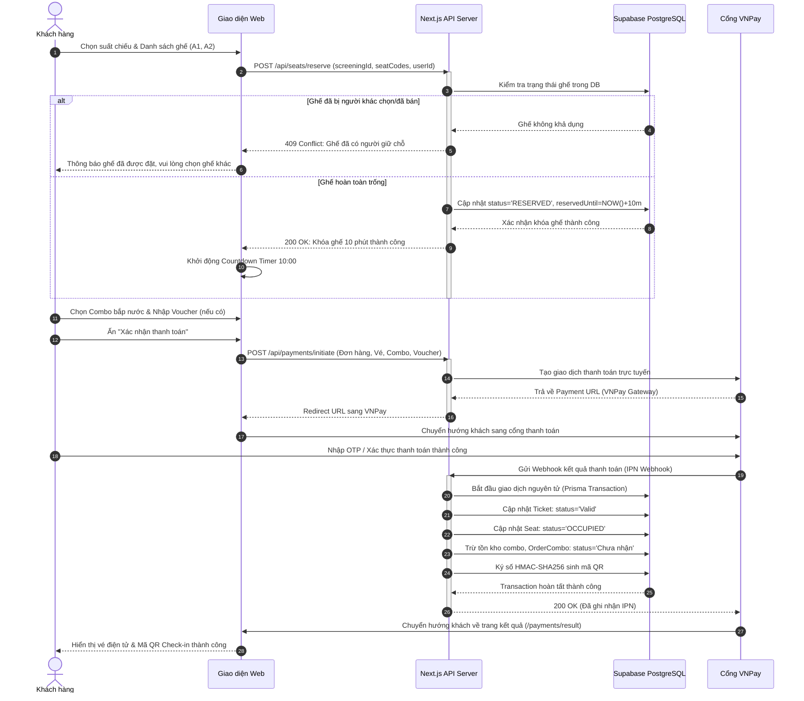
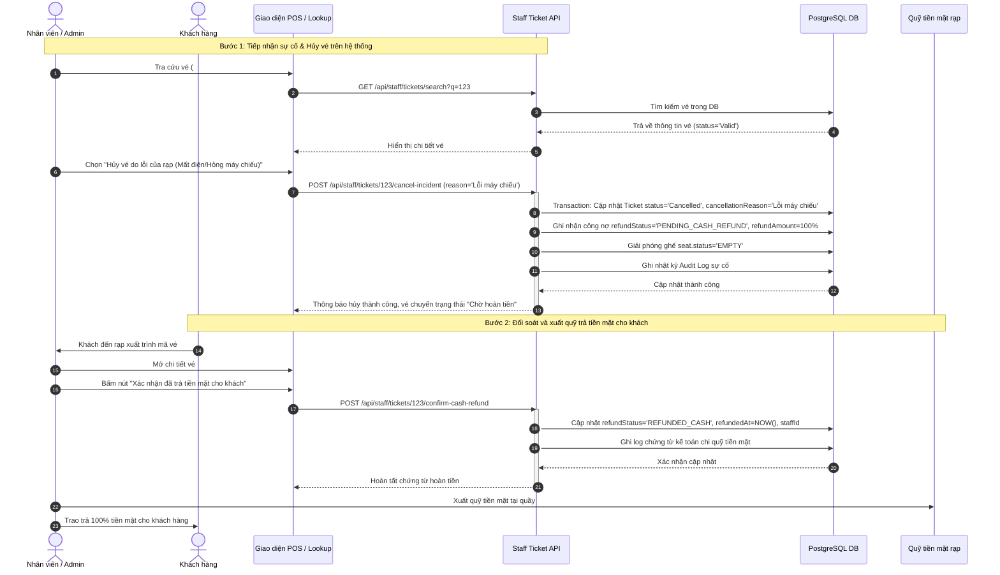
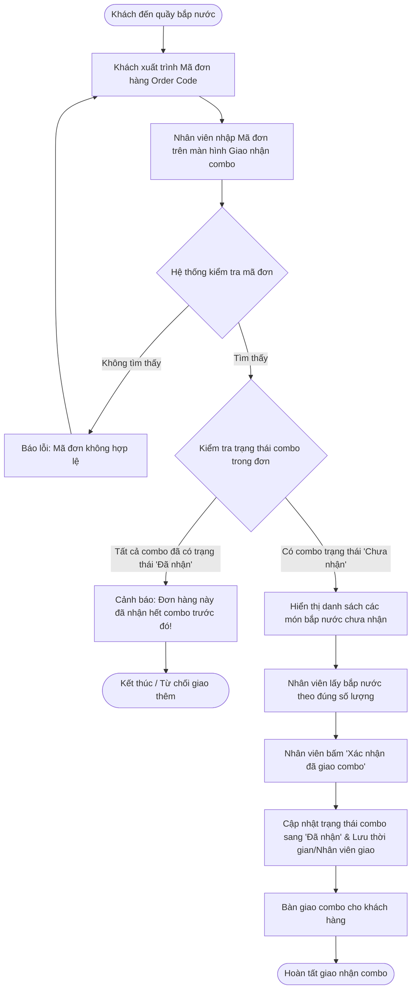
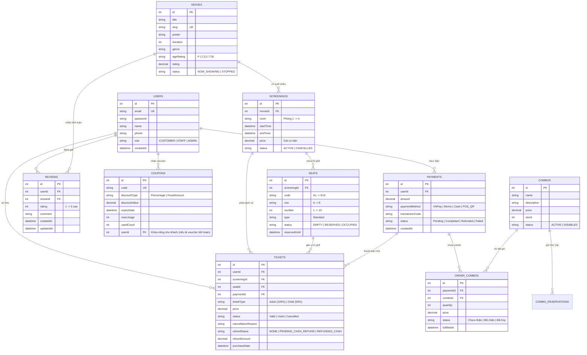

# TÀI LIỆU ĐẶC TẢ YÊU CẦU PHẦN MỀM (SRS - SOFTWARE REQUIREMENTS SPECIFICATION)
## HỆ THỐNG QUẢN LÝ BÁN VÉ VÀ VẬN HÀNH RẠP PHIM (LUMI CINEMA)

---

### BẢNG THEO DÕI THAY ĐỔI TÀI LIỆU (DOCUMENT REVISION HISTORY)

| Phiên bản (Version) | Ngày (Date) | Tác giả (Author) | Mô tả thay đổi (Description) | Trạng thái (Status) |
| :--- | :--- | :--- | :--- | :--- |
| **1.0** | 11/10/2026 | Nhóm phát triển sinh viên | Soạn thảo tài liệu đặc tả chuẩn IEEE 830 dựa trên Problem Statement và quy chế vận hành thực tế | Phê duyệt (Approved) |

---

## MỤC LỤC (TABLE OF CONTENTS)
1. **GIỚI THIỆU (INTRODUCTION)**
   - 1.1 Mục đích tài liệu (Purpose)
   - 1.2 Phạm vi sản phẩm (Product Scope)
   - 1.3 Định nghĩa, thuật ngữ và từ viết tắt (Definitions, Acronyms, and Abbreviations)
   - 1.4 Tài liệu tham khảo (References)
   - 1.5 Cấu trúc tài liệu (Document Overview)
2. **MÔ TẢ TỔNG QUAN (OVERALL DESCRIPTION)**
   - 2.1 Bối cảnh sản phẩm (Product Perspective)
   - 2.2 Các chức năng chính của sản phẩm (Product Functions)
   - 2.3 Các nhóm người dùng và đặc điểm (User Classes and Characteristics)
   - 2.4 Môi trường vận hành (Operating Environment)
   - 2.5 Ràng buộc thiết kế và triển khai (Design and Implementation Constraints)
   - 2.6 Giả định và phụ thuộc (Assumptions and Dependencies)
3. **CÁC YÊU CẦU GIAO DIỆN BÊN NGOÀI (EXTERNAL INTERFACE REQUIREMENTS)**
   - 3.1 Giao diện người dùng (User Interfaces - UI)
   - 3.2 Giao diện phần cứng (Hardware Interfaces)
   - 3.3 Giao diện phần mềm & Dịch vụ bên ngoài (Software Interfaces & Third-Party APIs)
   - 3.4 Giao diện truyền thông mạng (Communications Interfaces)
4. **CÁC TÍNH NĂNG HỆ THỐNG VÀ YÊU CẦU CHỨC NĂNG (SYSTEM FEATURES & FUNCTIONAL REQUIREMENTS)**
   - 4.1 Phân hệ Xác thực & Phân quyền (Authentication & Authorization)
   - 4.2 Phân hệ Đánh giá Phim (Movie Reviews)
   - 4.3 Phân hệ Đặt vé & Mua Combo Trực tuyến (Online Ticket & Combo Booking)
   - 4.4 Phân hệ Bán vé & Bán Combo Tại Quầy (POS Ticket & Standalone Combo Sales)
   - 4.5 Phân hệ Soát vé & Giao nhận Combo (Ticket Check-in & Combo Fulfillment)
   - 4.6 Phân hệ Hủy vé & Đền bù / Hoàn tiền (Ticket Cancellation & Compensation/Refund)
   - 4.7 Phân hệ Quản lý Voucher & Khuyến mãi (Voucher & Discount Engine)
   - 4.8 Phân hệ Quản trị Vận hành (Admin Operations & Incident Handling)
   - 4.9 Phân hệ Báo cáo & Thống kê Doanh thu (Reports & Financial Auditing)
5. **CÁC YÊU CẦU PHI CHỨC NĂNG (NON-FUNCTIONAL REQUIREMENTS - NFR)**
   - 5.1 Yêu cầu hiệu năng (Performance Requirements)
   - 5.2 Yêu cầu an toàn và xử lý đồng thời (Safety & Concurrency Requirements)
   - 5.3 Yêu cầu bảo mật (Security Requirements)
   - 5.4 Yêu cầu tính toàn vẹn dữ liệu và kiểm toán (Data Integrity & Audit Logging)
   - 5.5 Yêu cầu sao lưu và phục hồi (Backup & Recovery)
6. **MÔ HÌNH VÀ SƠ ĐỒ ĐẶC TẢ HỆ THỐNG (SYSTEM MODELS & DIAGRAMS)**
   - 6.1 Sơ đồ Use Case tổng quát (Overall Use Case Diagram)
   - 6.2 Sơ đồ tuần tự: Giữ ghế & Thanh toán trực tuyến (Sequence Diagram: Hold Seat & Payment)
   - 6.3 Sơ đồ tuần tự: Hủy vé do sự cố rạp & Hoàn tiền mặt (Sequence Diagram: Incident Refund)
   - 6.4 Sơ đồ hoạt động: Luồng giao nhận combo tại quầy (Activity Diagram: Combo Fulfillment)
   - 6.5 Sơ đồ dữ liệu thực thể quan hệ (ERD - Entity Relationship Diagram)
7. **PHỤ LỤC & MA TRẬN TRUY XUẤT YÊU CẦU (APPENDIX & TRACEABILITY MATRIX)**

---

## 1. GIỚI THIỆU (INTRODUCTION)

### 1.1 Mục đích tài liệu (Purpose)
Tài liệu này đặc tả chi tiết toàn bộ các yêu cầu phần mềm cho **Hệ thống Quản lý Bán vé và Vận hành Rạp phim (Lumi Cinema)** theo chuẩn IEEE 830. Tài liệu phục vụ cho:
- **Hội đồng chấm đồ án / Giảng viên:** Căn cứ đánh giá tính hoàn thiện, tính học thuật và mức độ đáp ứng chuẩn mực phân tích thiết kế hệ thống thông tin.
- **Nhóm phát triển phần mềm (Software Development Team):** Cẩm nang kỹ thuật trực tiếp để hiện thực hóa kiến trúc cơ sở dữ liệu (Database Schema), xây dựng các API Endpoints và giao diện tương tác người dùng (Frontend/Backend).
- **Bộ phận Vận hành / Kế toán (Stakeholders):** Đối soát quy trình nghiệp vụ (Business Rules), quy chế đền bù vé và kiểm soát tài chính.

### 1.2 Phạm vi sản phẩm (Product Scope)
- Hệ thống áp dụng cho một rạp chiếu phim duy nhất với quy mô:
  - **Số phòng chiếu:** 5 phòng chiếu tiêu chuẩn.
  - **Sơ đồ chỗ ngồi:** 50 ghế/phòng (Tổng cộng 250 ghế). Ghế cùng một loại chuẩn (Standard), ký hiệu hàng dọc từ A đến E, hàng ngang từ 1 đến 10 (từ A1 đến E10).
  - **Hai kênh phân phối:**
    1. Kênh trực tuyến (Website/Mobile Web): Dành riêng cho khách hàng có tài khoản định danh.
    2. Kênh tại quầy (POS - Point of Sale): Dành cho nhân viên quầy phục vụ cả khách định danh lẫn khách vãng lai.
  - **Hàng hóa kinh doanh:** Vé xem phim theo suất chiếu, phân loại giá theo độ tuổi (Vé Thường 100%, Vé Trẻ em 50%), bắp nước (Combo) đóng gói sẵn.
  - **Xử lý sự cố và đền bù:** Tự động hóa voucher bồi hoàn 50% khi khách chủ động hủy (hủy trước 2 giờ); quy trình đối soát thủ công hoàn tiền mặt 100% khi rạp gặp sự cố bất khả kháng (mất điện, hỏng máy chiếu).

### 1.3 Định nghĩa, thuật ngữ và từ viết tắt (Definitions, Acronyms, and Abbreviations)

| Thuật ngữ / Viết tắt | Tên đầy đủ (Tiếng Anh) | Định nghĩa chi tiết |
| :--- | :--- | :--- |
| **SRS** | Software Requirements Specification | Tài liệu đặc tả yêu cầu phần mềm. |
| **POS** | Point of Sale | Điểm bán vé và sản phẩm trực tiếp tại quầy của rạp. |
| **BR** | Business Rule | Quy tắc nghiệp vụ bắt buộc hệ thống phải tuân thủ. |
| **FR** | Functional Requirement | Yêu cầu chức năng của hệ thống. |
| **NFR** | Non-Functional Requirement | Yêu cầu phi chức năng (hiệu năng, bảo mật, đồng thời...). |
| **HMAC** | Hash-based Message Authentication Code | Mã xác thực tin nhắn dựa trên hàm băm mật mã học (dùng ký vé QR). |
| **JWT** | JSON Web Token | Chuỗi mã hóa dùng xác thực phiên làm việc người dùng không lưu trạng thái. |
| **Voucher bồi hoàn** | Compensation Voucher | Mã giảm giá 50% có hạn 30 ngày tự động phát sinh khi hủy vé do lỗi của khách. |
| **Chờ hoàn tiền** | Pending Refund | Trạng thái ghi nhận công nợ của rạp với khách khi vé bị hủy do sự cố rạp, chờ trả tiền mặt. |

### 1.4 Tài liệu tham khảo (References)
- Chuẩn IEEE Std 830-1998 (IEEE Recommended Practice for Software Requirements Specifications).
- Tài liệu quy chế đặc tả nghiệp vụ dự án Lumi Cinema (Bản cập nhật ngày 11/10/2026).
- Tài liệu tích hợp cổng thanh toán trực tuyến VNPay Sandbox (Version 2.1.0).

### 1.5 Cấu trúc tài liệu (Document Overview)
Tài liệu được phân chia thành 7 chương chính, từ tổng quan kiến trúc, đặc tả giao diện, mô tả chi tiết 9 phân hệ chức năng đến các sơ đồ kỹ thuật UML và ma trận kiểm soát truy xuất.

---

## 2. MÔ TẢ TỔNG QUAN (OVERALL DESCRIPTION)

### 2.1 Bối cảnh sản phẩm (Product Perspective)
Hệ thống Lumi Cinema là một ứng dụng Web Fullstack độc lập khép kín (Self-contained Web Application), bao gồm cổng thông tin khách hàng (Customer Portal), cổng nghiệp vụ quầy (Staff Portal) và bảng điều khiển quản trị (Admin Dashboard). Hệ thống liên kết ra ngoài với các cổng thanh toán trực tuyến và dịch vụ gửi Email/SMS thông báo.

### 2.2 Các chức năng chính của sản phẩm (Product Functions)
1. Quản lý xác thực tài khoản và kiểm soát quyền truy cập RBAC (Role-Based Access Control).
2. Tra cứu lịch chiếu, chọn ghế trực quan trên sơ đồ ma trận 5x10 (A-E, 1-10) và giữ chỗ trong 10 phút.
3. Thanh toán trực tuyến tích hợp và bán vé/bắp nước trực tiếp tại quầy POS.
4. Cơ chế soát vé điện tử bằng mã ký số HMAC-SHA256 (QR Code) và quản lý xuất kho combo bắp nước riêng biệt.
5. Xử lý hủy vé linh hoạt theo từng vé lẻ: Cấp voucher 50% tự động (lỗi khách) hoặc quy trình đối soát hoàn 100% tiền mặt (lỗi rạp).
6. Quản trị danh mục phim, kiểm soát nhãn độ tuổi (P, C13, T18...), điều phối suất chiếu không trùng giờ và quản lý tồn kho combo.
7. Báo cáo doanh thu đa chiều phân tách rõ ràng doanh thu thực thu, tiền chờ hoàn và tiền đã hoàn.

### 2.3 Các nhóm người dùng và đặc điểm (User Classes and Characteristics)

| Nhóm người dùng (Actor) | Trình độ & Đặc điểm | Quyền hạn và Trách nhiệm chính |
| :--- | :--- | :--- |
| **Khách hàng (Customer)** | Người dùng đại chúng, sử dụng trình duyệt Web/Mobile Web | Phải đăng ký tài khoản. Được xem phim, đặt vé online, mua combo online, đánh giá phim, tự hủy vé (trước 2h), quản lý voucher cá nhân. |
| **Nhân viên quầy (Staff)** | Nhân viên thu ngân/soát vé tại rạp, được đào tạo quy trình nội bộ | Sử dụng giao diện POS: Tạo đơn bán vé/combo tại quầy, bán combo độc lập, soát vé (Check-in), giao nhận combo, tra cứu và xử lý hủy vé theo sự cố. |
| **Quản trị viên (Admin)** | Ban quản lý rạp phim, nắm toàn quyền hệ thống | Quản lý phim, cấu hình phòng/suất chiếu, thiết lập giá vé, tạo chiến dịch voucher, kích hoạt hủy suất chiếu khẩn cấp, xuất báo cáo doanh thu tài chính. |

### 2.4 Môi trường vận hành (Operating Environment)
- **Hệ điều hành máy chủ:** Linux (Ubuntu 22.04 LTS) hoặc môi trường Node.js Containerized (Docker).
- **Hệ thống cơ sở dữ liệu:** PostgreSQL 15+ lưu trữ trên nền tảng Supabase Cloud.
- **Nền tảng ứng dụng:** Next.js (App Router), Node.js Runtime.
- **Trình duyệt máy khách:** Google Chrome, Mozilla Firefox, Apple Safari, Microsoft Edge phiên bản hiện đại.

### 2.5 Ràng buộc thiết kế và triển khai (Design and Implementation Constraints)
- **Quy mô rạp cố định:** Hệ thống thiết kế chuẩn cho 5 phòng chiếu, mỗi phòng 50 ghế đơn, tổng 250 ghế; các thuật toán tối ưu hóa cho cấu hình này.
- **Không hỗ trợ mua vé online vãng lai:** Mọi giao dịch online bắt buộc đăng nhập để chống giữ ghế ảo (Seat Squatting) và phục vụ bồi hoàn voucher.
- **Chính sách hoàn tiền:** Phase 1 thực hiện hoàn tiền mặt thủ công tại quầy kèm lưu vết đối soát kế toán, không gọi API hoàn tiền tự động qua cổng thanh toán.

### 2.6 Giả định và phụ thuộc (Assumptions and Dependencies)
- Cổng thanh toán đối tác (VNPay/Momo) phản hồi tín hiệu IPN (Instant Payment Notification) ổn định.
- Nếu dịch vụ Email/SMS gặp sự cố gián đoạn mạng, giao dịch đặt vé vẫn hoàn tất và vé được lưu trữ trực tiếp trong tài khoản của khách hàng để xuất trình.

---

## 3. CÁC YÊU CẦU GIAO DIỆN BÊN NGOÀI (EXTERNAL INTERFACE REQUIREMENTS)

### 3.1 Giao diện người dùng (User Interfaces - UI)
- **Màn hình Đăng nhập / Đăng ký:** Chứa trường nhập Email, Mật khẩu (tối thiểu 6 ký tự), Họ tên, Số điện thoại. Hiển thị thông báo lỗi rõ ràng nếu trùng email hoặc định dạng số điện thoại sai.
- **Màn hình Danh sách phim & Lịch chiếu:** Bộ lọc theo Ngày chiếu và Thể loại phim. Hiển thị Poster, Thời lượng, Nhãn độ tuổi và Đánh giá trung bình.
- **Màn hình Chọn ghế (Seat Matrix):** Sơ đồ trực quan 5 hàng (A -> E) và 10 cột (1 -> 10).
  - Trạng thái màu sắc: Ghế trống (Trắng/Xám), Ghế đang chọn (Đỏ/Vàng), Ghế đang giữ bởi người khác (Vàng nhạt mờ), Ghế đã bán (Xám đậm khóa chọn).
  - Đồng hồ đếm ngược 10 phút (Countdown Timer) hiển thị góc trên màn hình. Hết thời gian: Xóa phiên chọn ghế và chuyển hướng về trang chủ kèm thông báo.
- **Màn hình Chọn Combo:** Danh sách các gói bắp nước kèm hình ảnh, giá bán, số lượng tồn khả dụng và nút tăng/giảm số lượng.
- **Màn hình Thanh toán (Checkout):** Hiển thị chi tiết từng vé (Loại vé Thường/Trẻ em), ghế đã chọn, combo kèm theo, ô nhập mã Voucher, tổng tiền và lựa chọn cổng thanh toán.
- **Màn hình Chi tiết vé điện tử (Ticket Detail):** Mã vé dạng `#LMC-XXXXXX`, Mã QR xác thực ký số HMAC, thời gian suất chiếu, phòng chiếu, vị trí ghế và nút bấm "Hủy vé" (chỉ bật khi cách giờ chiếu >= 2 tiếng).
- **Màn hình Tra cứu & Nghiệp vụ Quầy (Staff POS & Lookup):** Ô tìm kiếm đa năng (SĐT, Email, Mã vé), nút Soát vé (Check-in), nút Xác nhận giao combo, nút Hủy vé & Đền bù đặc quyền, nút Xác nhận đã hoàn tiền mặt.

### 3.2 Giao diện phần cứng (Hardware Interfaces)
- Máy in nhiệt / Máy in hóa đơn tiêu chuẩn tại quầy kết nối qua cổng USB/LAN để in vé giấy và phiếu mã voucher cho khách vãng lai.
- Máy quét mã vạch / Đầu đọc mã QR 2D chuẩn cầm tay kết nối bàn phím (HID Keyboard emulation) phục vụ nhân viên quét vé vào cửa.

### 3.3 Giao diện phần mềm & Dịch vụ bên ngoài (Software Interfaces & Third-Party APIs)
1. **Cổng thanh toán VNPay:**
   - Endpoint khởi tạo URL: `vnpay/payment/create` (Truyền mã đơn, số tiền, thông tin đơn hàng, URL trả về).
   - Cơ chế IPN: Nhận Webhook kiểm tra chữ ký SHA512 đảm bảo chống gian lận đơn hàng.
2. **Dịch vụ Email / SMS:**
   - Gửi thư xác nhận thanh toán kèm thông tin vé và gửi thông báo cấp mã Voucher bồi hoàn.
3. **Cơ sở dữ liệu đám mây Supabase / PostgreSQL:**
   - Giao thức kết nối qua Prisma ORM với Connection Pooling bảo đảm chịu tải cao trong giờ cao điểm mở bán vé.

### 3.4 Giao diện truyền thông mạng (Communications Interfaces)
- Toàn bộ giao tiếp giữa Client và Server sử dụng giao thức bảo mật mã hóa **HTTPS/TLS 1.3**.
- Dữ liệu trao đổi qua chuẩn RESTful API với định dạng nội dung `application/json`.

---

## 4. CÁC TÍNH NĂNG HỆ THỐNG VÀ YÊU CẦU CHỨC NĂNG (SYSTEM FEATURES & FUNCTIONAL REQUIREMENTS)

### 4.1 Phân hệ Xác thực & Phân quyền (Authentication & Authorization)
- **FR-AUTH-01 (Đăng ký tài khoản):** Cho phép người dùng đăng ký vai trò Khách hàng với các trường bắt buộc: Email (duy nhất, đúng định dạng RFC 5322), Mật khẩu (>= 6 ký tự), Họ tên, Số điện thoại.
- **FR-AUTH-02 (Đăng nhập hệ thống):** Xác thực tài khoản qua Email và Mật khẩu (đã mã hóa bcrypt với salt round = 12). Cấp phát JWT phiên làm việc thời hạn 24 giờ.
- **FR-AUTH-03 (Phân quyền truy cập RBAC):** Kiểm soát truy cập nghiêm ngặt:
  - Role `CUSTOMER`: Chỉ truy cập các trang đặt vé cá nhân, lịch sử vé, hồ sơ và đánh giá.
  - Role `STAFF`: Truy cập Dashboard nhân viên, màn hình bán vé tại quầy, tra cứu vé, soát vé và giao combo.
  - Role `ADMIN`: Toàn quyền quản trị hệ thống, danh mục, suất chiếu, giá, voucher, báo cáo tài chính và hủy suất chiếu khẩn cấp.
- **FR-AUTH-04 (Tài khoản nội bộ):** Tài khoản Nhân viên và Admin được khởi tạo sẵn trong cơ sở dữ liệu ban đầu, không mở form đăng ký công khai.

### 4.2 Phân hệ Đánh giá Phim (Movie Reviews)
- **FR-REV-01 (Điều kiện đánh giá):** Khách hàng chỉ cần đăng nhập tài khoản thành công là có quyền gửi đánh giá (Rating từ 1 đến 5 sao) và viết bình luận (tối đa 1000 ký tự) cho bất kỳ bộ phim nào đang hoặc đã chiếu. Không ràng buộc điều kiện phải mua vé hoặc xem phim trước đó.
- **FR-REV-02 (Cập nhật đánh giá duy nhất):** Mỗi khách hàng chỉ có duy nhất 1 bản ghi đánh giá cho một bộ phim. Nếu gửi lại, hệ thống tự động cập nhật số sao và nội dung bình luận trước đó.
- **FR-REV-03 (Tính điểm trung bình):** Hệ thống tự động tính toán lại điểm đánh giá trung bình của phim (làm tròn 1 chữ số thập phân) ngay sau khi có lượt đánh giá mới hoặc chỉnh sửa, hiển thị công khai trên danh sách phim.

### 4.3 Phân hệ Đặt vé & Mua Combo Trực tuyến (Online Ticket & Combo Booking)
- **FR-BOK-01 (Lọc lịch chiếu):** Cho phép xem danh sách phim đang chiếu và lọc suất chiếu theo ngày chiếu, thể loại phim và phòng chiếu.
- **FR-BOK-02 (Giữ chỗ ghế 10 phút):**
  - Khách hàng chọn tối đa số ghế quy định trong 1 giao dịch. Hệ thống chuyển trạng thái ghế sang `RESERVED` và thiết lập `reservedUntil = NOW() + 10 phút`.
  - Trong thời gian 10 phút, ghế này bị khóa không cho bất kỳ người dùng nào khác chọn.
  - Cơ chế nền (Cron Job / Background Trigger) tự động giải phóng ghế về `EMPTY` nếu quá 10 phút mà đơn hàng chưa hoàn tất thanh toán.
- **FR-BOK-03 (Phân loại giá vé theo độ tuổi):**
  - Khách hàng chọn loại vé cho từng ghế: Vé Thường (100% giá cơ bản) hoặc Vé Trẻ em (50% giá cơ bản).
  - Ràng buộc: Vé Trẻ em chỉ được phép chọn đối với các phim có nhãn độ tuổi phù hợp (Ví dụ: phim có nhãn P hoặc C13; phim T18 tuyệt đối khóa lựa chọn vé Trẻ em).
- **FR-BOK-04 (Mua kèm Combo & Giữ kho tồn):** Hệ thống gợi ý danh sách combo có tồn kho khả dụng > 0. Khi khách chọn combo, số lượng tồn kho tương ứng bị giữ chỗ tạm thời trong 10 phút đồng bộ với phiên giữ ghế.
- **FR-BOK-05 (Thanh toán & Xuất vé):** Sau khi cổng thanh toán xác nhận giao dịch thành công (IPN Success):
  - Chuyển trạng thái các vé sang `Valid`.
  - Chuyển ghế sang `OCCUPIED`.
  - Trừ kho combo chính thức.
  - Thiết lập trạng thái combo trong đơn hàng là `Chưa nhận`.
  - Tự động sinh mã ký điện tử HMAC-SHA256 trên mã vé để tạo mã QR Code.

### 4.4 Phân hệ Bán vé & Bán Combo Tại Quầy (POS Sales)
- **FR-POS-01 (Bán vé tại rạp):** Nhân viên chọn suất chiếu, chọn ghế trên sơ đồ, chọn loại vé (Thường/Trẻ em) cho từng ghế, kiểm tra giấy tờ độ tuổi của khách nếu áp dụng vé Trẻ em.
- **FR-POS-02 (Gắn định danh hoặc Khách vãng lai):** Cho phép nhân viên tìm kiếm tài khoản khách bằng Số điện thoại/Email để tích điểm/lưu vé; nếu là khách vãng lai, cho phép hoàn tất giao dịch mà không yêu cầu tài khoản.
- **FR-POS-03 (Bán Combo độc lập):** Cho phép nhân viên bán trực tiếp bắp nước tại quầy mà không cần chọn phim hay suất chiếu (phục vụ khách vãng lai hoặc khách đã mua vé online từ trước muốn mua thêm bắp nước).
- **FR-POS-04 (Hình thức thanh toán tại quầy):** Hỗ trợ thu Tiền mặt hoặc Quét mã Chuyển khoản QR. Sau khi nhân viên xác nhận "Đã thu tiền", hệ thống in vé/phiếu mua hàng cho khách.

### 4.5 Phân hệ Soát vé & Giao nhận Combo (Ticket Check-in & Combo Fulfillment)
- **FR-CHK-01 (Soát vé vào rạp):** Nhân viên quét mã QR trên vé hoặc nhập mã vé `#LMC-XXXXXX`. Hệ thống hợp lệ vé nếu:
  1. Vé có trạng thái `Valid`.
  2. Suất chiếu thuộc đúng phòng và thời gian hiện tại nằm trong khung: Từ 30 phút trước giờ bắt đầu chiếu đến thời điểm kết thúc suất chiếu.
  - Khi hợp lệ: Hệ thống chuyển trạng thái vé sang `Used`. Vé `Used` bị từ chối nếu quét lại lần hai.
- **FR-CHK-02 (Giao nhận Combo độc lập):**
  - Khách hàng đã đặt combo online xuất trình mã đơn hàng (Order Code) tại quầy bắp nước.
  - Nhân viên nhập mã đơn hàng: Màn hình hiển thị chi tiết các gói combo và trạng thái tương ứng.
  - Nhân viên ấn "Xác nhận đã giao combo": Hệ thống chuyển trạng thái combo từ `Chưa nhận` sang `Đã nhận`.
  - Quy trình nhận combo độc lập hoàn toàn với việc soát vé (Khách có thể nhận bắp nước trước khi soát vé vào phòng chiếu hoặc ngược lại). Hệ thống chặn tuyệt đối việc nhận trùng các gói combo đã ghi nhận `Đã nhận`.

### 4.6 Phân hệ Hủy vé & Đền bù / Hoàn tiền (Ticket Cancellation & Compensation/Refund)

| Trường hợp hủy vé | Điều kiện tiên quyết | Hình thức bồi hoàn | Tác động Ghế & Combo |
| :--- | :--- | :--- | :--- |
| **Khách hàng chủ động tự hủy (Online / Quầy)** | 1. Vé có trạng thái `Valid`. 2. Thời điểm hủy cách giờ chiếu **>= 2 tiếng**. | **Cấp Voucher giảm 50%** cho lần mua vé sau (Hạn dùng 30 ngày). Tuyệt đối **không hoàn tiền mặt/chuyển khoản**. | - Ghế được giải phóng về `EMPTY` ngay lập tức. - Combo đi kèm giữ nguyên hiệu lực theo mã đơn, khách vẫn đến nhận bình thường. |
| **Hủy do sự cố rạp (Mất điện, lỗi máy chiếu...)** | 1. Vé chưa qua sử dụng (Status `Valid`). 2. Nhân viên hoặc Admin thực hiện. 3. **Không áp dụng điều kiện trước 2 tiếng**. | **Hoàn 100% tiền mặt** số tiền thực trả của vé (sau khi trừ các voucher đã áp dụng). Không cấp voucher. | - Ghế giải phóng về `EMPTY`. - Nếu hủy toàn bộ đơn/suất chiếu: Combo `Chưa nhận` được hoàn tiền mặt 100% và cộng lại tồn kho. Combo `Đã nhận` không hoàn tiền và không hoàn kho. |

- **FR-CAN-01 (Hủy từng vé độc lập):** Trong một đơn hàng gồm nhiều vé, cho phép hủy từng vé lẻ nếu vé đó đáp ứng điều kiện hủy mà không làm ảnh hưởng đến các vé còn lại trong đơn.
- **FR-CAN-02 (Quy trình hoàn tiền mặt thủ công Phase 1):**
  - Khi vé bị hủy do lỗi rạp, hệ thống ghi nhận trạng thái vé là `Cancelled` kèm ghi chú công nợ `Chờ hoàn tiền`.
  - Khách mua vé online có thời hạn 30 ngày kể từ khi có thông báo để đến rạp xuất trình mã vé nhận tiền mặt. Quá 30 ngày, quyền nhận hoàn tiền bị vô hiệu hóa.
  - Khi khách đến rạp nhận tiền, Nhân viên hoặc Admin tra cứu vé, bấm nút "Xác nhận đã hoàn tiền mặt": Hệ thống chuyển trạng thái ghi nhận `Đã hoàn tiền`, đồng thời lưu vết Audit Log gồm ID nhân viên thực hiện, thời gian và số tiền chi quỹ để đối soát kế toán.
- **FR-CAN-03 (Chặn hủy vé đã sử dụng):** Vé đã có trạng thái `Used` tuyệt đối không được hủy hoặc hoàn tiền dưới bất kỳ lý do nào (kể cả khi rạp phát sinh sự cố trong suất chiếu).

### 4.7 Phân hệ Quản lý Voucher & Khuyến mãi (Voucher & Discount Engine)
- **FR-VOU-01 (Hai loại Voucher):**
  1. *Voucher Khuyến mãi (Admin Campaign):* Tạo bởi Admin, áp dụng theo mã chiến dịch cho toàn bộ khách hàng.
  2. *Voucher Bồi hoàn (System Compensation):* Do hệ thống tự sinh định dạng `COMP50_[TicketID]_[Random]`, cấp riêng cho tài khoản khách (hoặc in mã cho khách vãng lai) khi hủy vé do lỗi của khách.
- **FR-VOU-02 (Quy tắc áp dụng Voucher):**
  - Mỗi đơn hàng chỉ được sử dụng tối đa 1 voucher.
  - Giảm giá chỉ áp dụng trên tiền vé xem phim, không áp dụng trên tiền combo bắp nước.
  - Công thức tính: `Tổng đơn = (Tổng tiền vé sau hệ số loại vé - Tiền giảm voucher) + Tổng tiền combo`.
  - Đối với Voucher bồi hoàn 50%: Chỉ giảm tối đa 50% giá trị của duy nhất 1 vé trong đơn hàng mới.
- **FR-VOU-03 (Hoàn trả lượt dùng khi thanh toán lỗi):** Nếu khách hàng áp dụng voucher nhưng hủy thanh toán hoặc hết hạn 10 phút giữ ghế, hệ thống tự động hoàn lại lượt sử dụng cho voucher đó. Nếu đơn hàng thanh toán thành công mà sau đó vé bị hủy, lượt dùng của voucher ban đầu không được hoàn lại.

### 4.8 Phân hệ Quản trị Vận hành (Admin Operations & Incident Handling)
- **FR-ADM-01 (Quản lý danh mục phim & Nhãn độ tuổi):** Thêm mới, chỉnh sửa phim. Thiết lập nhãn độ tuổi (P: Mọi lứa tuổi, C13: Cấm dưới 13 tuổi, T18: Cấm dưới 18 tuổi).
- **FR-ADM-02 (Xóa mềm phim):** Phim đã từng phát sinh suất chiếu hoặc có giao dịch vé tuyệt đối không được xóa khỏi cơ sở dữ liệu (Hard Delete). Chỉ cho phép chuyển trạng thái sang `Ngừng chiếu` (Soft Delete) để đảm bảo toàn vẹn dữ liệu lịch sử và báo cáo.
- **FR-ADM-03 (Lên lịch suất chiếu & Chống trùng phòng):**
  - Khi tạo suất chiếu mới, hệ thống tự động kiểm tra thời gian: `Thời gian kết thúc = Giờ bắt đầu + Thời lượng phim`.
  - Ràng buộc: Trong cùng một phòng chiếu, không được có bất kỳ hai suất chiếu nào có khoảng thời gian giao nhau.
  - Khi khởi tạo suất chiếu thành công, hệ thống tự động tạo sẵn 50 bản ghi ghế trống (từ A1 đến E10).
- **FR-ADM-04 (Hủy suất chiếu khẩn cấp do sự cố):**
  - Admin có thẩm quyền kích hoạt hủy toàn bộ suất chiếu khi gặp sự cố phòng chiếu nghiêm trọng.
  - Hệ thống tự động:
    1. Chuyển trạng thái suất chiếu sang `Cancelled` và ngừng bán vé.
    2. Hủy toàn bộ các vé chưa sử dụng của suất chiếu đó, ghi nhận công nợ `Chờ hoàn tiền 100%`.
    3. Giải phóng trạng thái ghế nhưng khóa không cho đặt lại trên suất chiếu này.
    4. Ghi nhận nhật ký kiểm toán hệ thống.

### 4.9 Phân hệ Báo cáo & Thống kê Doanh thu (Reports & Financial Auditing)
- **FR-REP-01 (Bộ lọc báo cáo):** Cho phép Admin xem thống kê doanh thu theo khoảng thời gian tùy chọn (theo ngày, tháng, năm), theo phim, theo suất chiếu và theo kênh bán vé (Online vs Tại quầy POS).
- **FR-REP-02 (Các chỉ số tài chính bắt buộc):**
  - Tổng số vé đã bán, tổng số vé đã hủy.
  - Doanh thu bán vé thực thu (Net Ticket Revenue).
  - Doanh thu combo bắp nước (Combo Revenue).
  - Tổng tiền công nợ chờ hoàn (Pending Refund Amount).
  - Tổng tiền thực tế đã xuất quỹ chi trả cho khách (Actual Refunded Amount).
- **FR-REP-03 (Tính nhất quán kế toán):** Báo cáo phân biệt rõ giữa "Khoản chờ hoàn" và "Khoản đã hoàn tiền mặt thực tế", không ghi giảm doanh thu hai lần cho cùng một vé bị hủy.

---

## 5. CÁC YÊU CẦU PHI CHỨC NĂNG (NON-FUNCTIONAL REQUIREMENTS - NFR)

### 5.1 Yêu cầu hiệu năng (Performance Requirements)
- **NFR-PERF-01 (Thời gian phản hồi trang):** Thời gian tải trang ban đầu (First Contentful Paint) không vượt quá 3.0 giây trong điều kiện kết nối internet băng thông tiêu chuẩn.
- **NFR-PERF-02 (Tốc độ giao dịch giữ chỗ):** Thao tác khóa giữ ghế (Seat Locking) và xác nhận đơn hàng qua API phải hoàn tất xử lý dưới 500ms để đảm bảo trải nghiệm mượt mà.

### 5.2 Yêu cầu an toàn và xử lý đồng thời (Safety & Concurrency Requirements)
- **NFR-SAFE-01 (Chống bán trùng ghế - Concurrency Control):** Hệ thống phải sử dụng kỹ thuật Transaction Isolation (Serializable hoặc Pessimistic/Optimistic Locking) trong cơ sở dữ liệu để đảm bảo: Tuyệt đối không bao giờ xảy ra tình trạng hai khách hàng cùng giữ chỗ hoặc cùng mua thành công một vị trí ghế trong cùng một suất chiếu tại cùng một thời điểm.

### 5.3 Yêu cầu bảo mật (Security Requirements)
- **NFR-SEC-01 (Mã hóa mật khẩu):** Mật khẩu người dùng phải được băm bảo mật bằng thuật toán **bcrypt** với số vòng muối (salt rounds) tối thiểu là 12 trước khi ghi vào cơ sở dữ liệu. Tuyệt đối không lưu trữ mật khẩu dưới dạng văn bản rõ (plain text).
- **NFR-SEC-02 (Bảo mật vé điện tử & Chống làm giả):** Mã QR Code trên vé điện tử bắt buộc phải chứa chuỗi chữ ký điện tử mật mã học **HMAC-SHA256**, được ký bằng khóa bí mật phía máy chủ (`NEXTAUTH_SECRET`). Khi nhân viên quét mã, máy chủ tiến hành giải mã và xác thực chữ ký số; nếu mã QR bị chỉnh sửa dù chỉ 1 ký tự, hệ thống lập tức từ chối và cảnh báo vé giả mạo.

### 5.4 Yêu cầu tính toàn vẹn dữ liệu và kiểm toán (Data Integrity & Audit Logging)
- **NFR-INT-01 (Bảo vệ giao dịch thanh toán Idempotency):** Hệ thống đảm bảo tính lũy đẳng (Idempotent) đối với tín hiệu phản hồi từ cổng thanh toán. Nếu cổng thanh toán gửi lại kết quả IPN nhiều lần cho một giao dịch, hệ thống chỉ cập nhật đơn hàng và tạo vé duy nhất 1 lần, không phát sinh trùng lặp.
- **NFR-INT-02 (Nhật ký kiểm toán Audit Trail):** Mọi hành động nhạy cảm bao gồm: Hủy vé, xác nhận chi quỹ hoàn tiền mặt, hủy suất chiếu và phát hành voucher bồi hoàn đều phải được ghi nhận vào bảng Audit Log với đầy đủ thông tin: ID tài khoản thực hiện, vai trò, IP truy cập, lý do và dấu thời gian chính xác (ISO Timestamp).

### 5.5 Yêu cầu sao lưu và phục hồi (Backup & Recovery)
- **NFR-BCK-01 (Sao lưu tự động):** Cơ sở dữ liệu đám mây Supabase kích hoạt chế độ sao lưu tự động hàng ngày (Daily Automatic Backup) với khả năng phục hồi dữ liệu về điểm thời gian cụ thể (Point-in-Time Recovery - PITR) trong trường hợp có sự cố thảm họa.

---

## 6. MÔ HÌNH VÀ SƠ ĐỒ ĐẶC TẢ HỆ THỐNG (SYSTEM MODELS & DIAGRAMS)

### 6.1 Sơ đồ Use Case tổng quát (Overall Use Case Diagram)

```mermaid
graph TD
    actorCustomer["Khách hàng (Customer)"]
    actorStaff["Nhân viên quầy (Staff)"]
    actorAdmin["Quản trị viên (Admin)"]

    subgraph "Hệ Thống Quản Lý Rạp Phim Lumi Cinema"
        UC_Auth["Đăng ký / Đăng nhập"]
        UC_Review["Đánh giá & Bình luận phim"]
        UC_BookOnline["Đặt vé & Mua combo Online"]
        UC_CancelSelf["Tự hủy vé online (trước 2h, nhận voucher 50%)"]
        
        UC_POS["Bán vé & Bán combo tại quầy (POS)"]
        UC_CheckIn["Soát vé vào rạp (Check-in QR)"]
        UC_FulfillCombo["Xác nhận giao nhận combo tại quầy"]
        UC_StaffCancel["Hủy vé sự cố quầy & Hoàn tiền mặt"]

        UC_MovieMgmt["Quản lý Phim & Nhãn độ tuổi"]
        UC_ScreeningMgmt["Lên lịch suất chiếu (Chống trùng phòng)"]
        UC_Pricing["Thiết lập bảng giá vé"]
        UC_ComboMgmt["Quản lý danh mục & Tồn kho Combo"]
        UC_VoucherMgmt["Quản lý chiến dịch Voucher"]
        UC_CancelScreening["Hủy suất chiếu khẩn cấp do sự cố"]
        UC_Report["Xem báo cáo doanh thu & Đối soát tài chính"]
    end

    actorCustomer --> UC_Auth
    actorCustomer --> UC_Review
    actorCustomer --> UC_BookOnline
    actorCustomer --> UC_CancelSelf

    actorStaff --> UC_Auth
    actorStaff --> UC_POS
    actorStaff --> UC_CheckIn
    actorStaff --> UC_FulfillCombo
    actorStaff --> UC_StaffCancel

    actorAdmin --> UC_Auth
    actorAdmin --> UC_MovieMgmt
    actorAdmin --> UC_ScreeningMgmt
    actorAdmin --> UC_Pricing
    actorAdmin --> UC_ComboMgmt
    actorAdmin --> UC_VoucherMgmt
    actorAdmin --> UC_CancelScreening
    actorAdmin --> UC_Report
    actorAdmin --> UC_StaffCancel
```

---

### 6.2 Sơ đồ tuần tự: Giữ ghế & Thanh toán trực tuyến (Sequence Diagram: Hold Seat & Payment)

---

### 6.3 Sơ đồ tuần tự: Hủy vé do sự cố rạp & Hoàn tiền mặt (Sequence Diagram: Incident Refund)

---

### 6.4 Sơ đồ hoạt động: Luồng giao nhận combo tại quầy (Activity Diagram: Combo Fulfillment)

---

### 6.5 Sơ đồ dữ liệu thực thể quan hệ (ERD - Entity Relationship Diagram)

---

## 7. PHỤ LỤC & MA TRẬN TRUY XUẤT YÊU CẦU (APPENDIX & TRACEABILITY MATRIX)

### Ma trận truy xuất từ Yêu cầu nghiệp vụ sang Chức năng phần mềm (BR to FR Traceability Matrix)

| Mã nghiệp vụ (Business Rule ID) | Nội dung nghiệp vụ thực tế | Yêu cầu chức năng đáp ứng (FR ID) | Bảng dữ liệu liên quan (Database Tables) |
| :--- | :--- | :--- | :--- |
| **BR-01** | Phòng chiếu cố định 50 ghế (A-E, 1-10), giữ chỗ 10 phút. | `FR-BOK-02`, `NFR-SAFE-01` | `screenings`, `seats` |
| **BR-02** | Phân loại vé: Thường (100%), Trẻ em (50%). Kiểm soát nhãn tuổi. | `FR-BOK-03`, `FR-ADM-01` | `movies`, `tickets` |
| **BR-03** | Khách chủ động hủy vé: Bắt buộc trước 2h, cấp voucher 50%, không hoàn tiền. | `FR-CAN-01`, `FR-VOU-01` | `tickets`, `coupons` |
| **BR-04** | Hủy vé do lỗi rạp: Không cần trước 2h, hoàn 100% tiền mặt thủ công trong 30 ngày. | `FR-CAN-02`, `FR-ADM-04` | `tickets`, `payments` |
| **BR-05** | Nhận combo độc lập với soát vé; không giao trùng combo. | `FR-CHK-02`, `FR-POS-03` | `order_combos`, `combos` |
| **BR-06** | Đánh giá phim: Chỉ cần đăng nhập, không bắt buộc đã xem phim. | `FR-REV-01`, `FR-REV-02` | `reviews`, `movies` |
| **BR-07** | Phim đã có giao dịch không xóa vĩnh viễn, chỉ ngừng chiếu. | `FR-ADM-02` | `movies` |
| **BR-08** | Lên lịch chiếu chống trùng thời gian trong cùng phòng chiếu. | `FR-ADM-03` | `screenings` |
| **BR-09** | Vé điện tử chống làm giả bằng chữ ký bảo mật HMAC-SHA256. | `FR-CHK-01`, `NFR-SEC-02` | `tickets` |
| **BR-10** | Tính phân biệt kế toán: Doanh thu thực thu, tiền chờ hoàn và tiền đã hoàn. | `FR-REP-02`, `FR-REP-03` | `tickets`, `payments` |

---
*(Hết tài liệu đặc tả - Bản quyền thuộc về Nhóm phát triển Dự án Lumi Cinema)*
